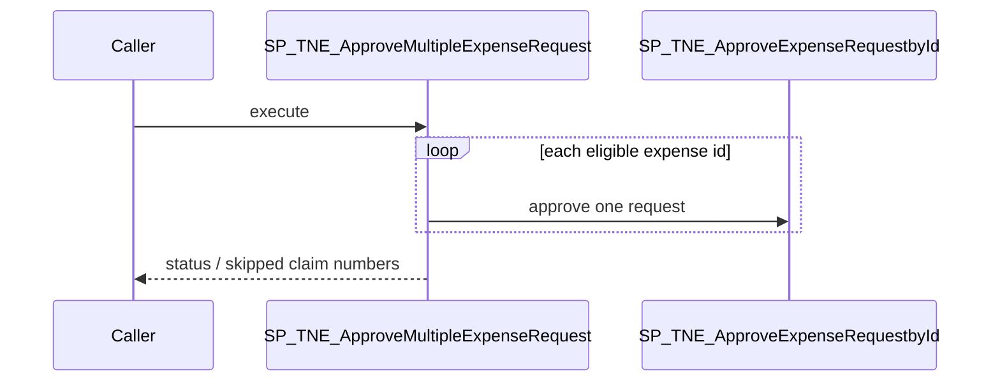
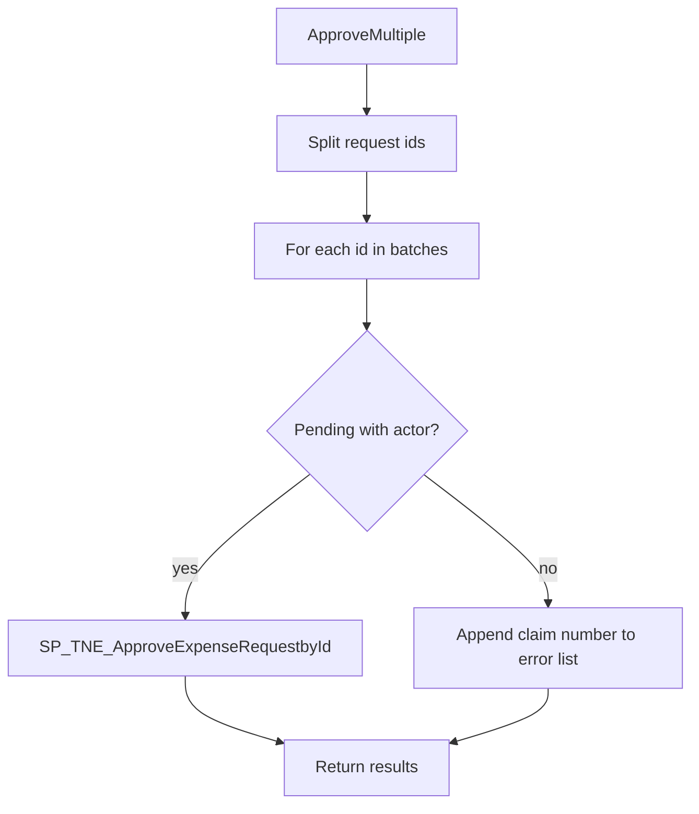

# SP_TNE_ApproveMultipleExpenseRequest

## What it does

Bulk-approves a comma-separated list of expense ids for the logged-in approver. Builds the actor's employer set (global access vs single employer), batches ids (10 at a time), and for each id that is still pending with the actor in `TRequestWorkflows`, executes `SP_TNE_ApproveExpenseRequestbyId`. Collects claim numbers that could not be approved into an error message payload.

## Parameters

| Name | Direction | What it is for |
|---|---|---|
| `@RequestId` | in | Comma-separated expense ids |
| `@EmployeeId` | in | Logged-in approver |
| `@Employerid` | in | Caller employer context |
| `@Comments` | in | Approval comments |

## Call sequence

## Callers

App: `ExpenseDAL.ApproveMultipleExpenseRequest` → `ExpenseController.ApproveMultipleExpenseRequest` from Notification/Team bulk approve on [Expense Requests](/docs/guides/expense-and-reimbursement/expense-requests).

## Nested

| Object | Kind | When | Page |
|---|---|---|---|
| `SP_TNE_ApproveExpenseRequestbyId` | procedure | expense still pending with actor | [SP_TNE_ApproveExpenseRequestbyId](/docs/database/hrms-travelnexpense/SP_TNE_ApproveExpenseRequestbyId) |

## Steps

1. Script is `SP_TNE_ApproveMultipleExpenseRequest.sql` (header contains `USE [TravelNExpense_Prod]`).
2. Resolve `@MultipleEmployerids` from user global-access employers.
3. Split `@RequestId` into `#EXPENSEID`; process in batches of 10.
4. Per id, begin transaction; load claim; resolve module page name from `TEMAIL_NOTIFICATION`; check pending managers; `EXEC SP_TNE_ApproveExpenseRequestbyId` or append skip message; commit/rollback.

## Tables

| Table | Read or write |
|---|---|
| `TEXPENSE` | read |
| `TRequestWorkflows` | read |
| `TEMAIL_NOTIFICATION` | read |
| `TUsers` / `TUserEmployee` / `TEmployerDetails` | read (employer set) |

## Unresolved calls

None at one nested level beyond `SP_TNE_ApproveExpenseRequestbyId`.

## Flow

