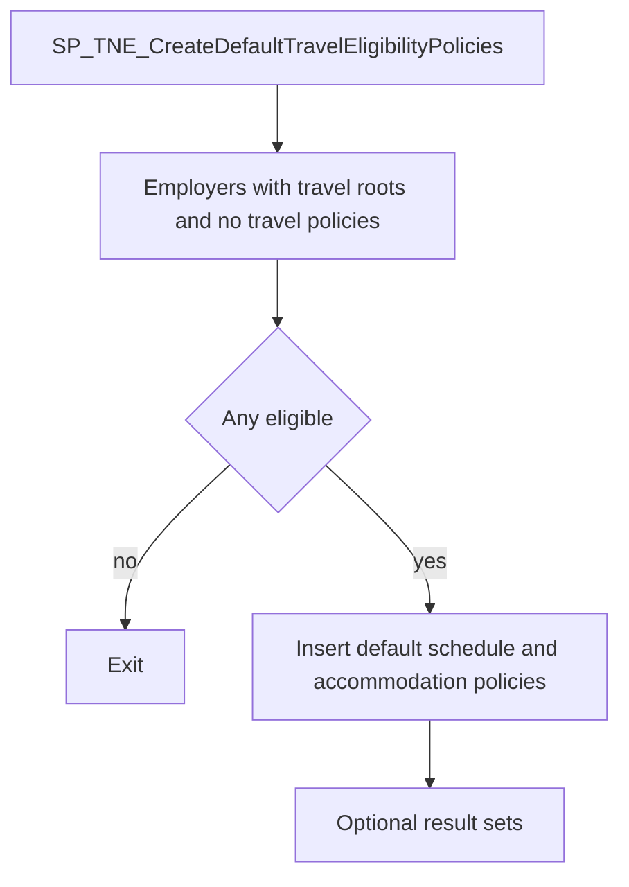

# SP_TNE_CreateDefaultTravelEligibilityPolicies

## What it does

Stored procedure `SP_TNE_CreateDefaultTravelEligibilityPolicies`. For employers that have travel roots `1400` (schedule) and/or `1440` (accommodation) in `TNE_TypeRegistry` and no existing travel-module policies, creates default schedule and accommodation eligibility policies. Called after Options Setup copies lookups. Calls no nested procedure.

## Parameters

| Name | Direction | What it is for |
|---|---|---|
| `@SuppressOutput` | in | BIT, default 0 — when 1, suppresses SELECT result sets for nested callers |

## Call sequence

Calls no other procedures or functions.

## Callers

| Caller | Page |
|---|---|
| [`SP_TNE_AddingNewEmployerInTLookup`](/docs/database/hrms-travelnexpense/SP_TNE_AddingNewEmployerInTLookup) | [`/docs/database/hrms-travelnexpense/SP_TNE_AddingNewEmployerInTLookup`](/docs/database/hrms-travelnexpense/SP_TNE_AddingNewEmployerInTLookup) |

## Nested

Calls no other procedures or functions.

## Steps

1. Script is `HRMS-DATABASE/HRMS_TRAVELNEXPENSE/STOREPROCEDURE/SP_TNE_CreateDefaultTravelEligibilityPolicies.sql`.
2. Find employers with active travel roots 1400/1440 and no travel `Policies`.
3. Insert default schedule and accommodation eligibility policies/payloads/history for those roots when present.
4. Optionally return summary result sets unless `@SuppressOutput = 1`.

## Tables

| Table | Read or write |
|---|---|
| `TNE_TypeRegistry` | read |
| `Policies` | read and write |
| `PolicyPayloads` | write |
| policy history / eligibility payload tables used in script | write |

## Flow

