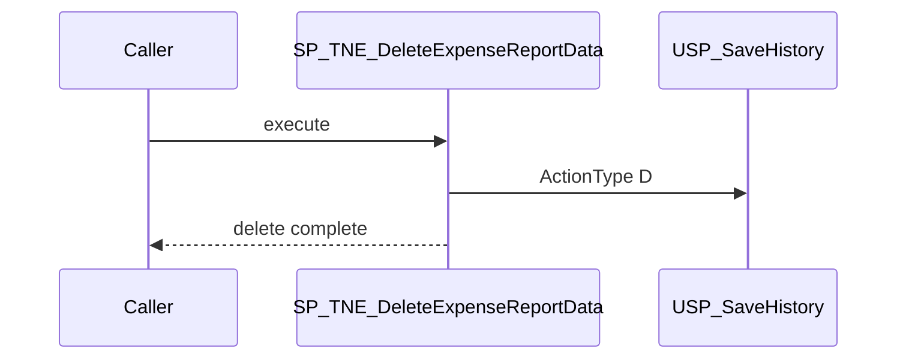
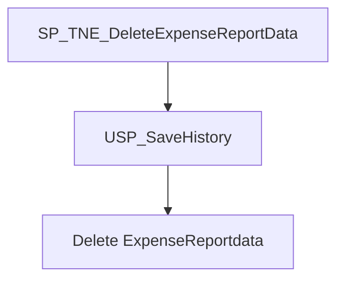

# SP_TNE_DeleteExpenseReportData

## What it does

Deletes one saved expense report after writing a history snapshot via `USP_SaveHistory` (action `D`, history created-by `0`).

## Parameters

| Name | Direction | What it is for |
|---|---|---|
| `@ReportID` | in | Primary key to delete |

## Call sequence

## Callers

| Caller | Page |
|---|---|
| `ReportsDAL.DeleteExpenseSavedReportData` | [Report](/docs/guides/expense-and-reimbursement/report) |

## Nested

| Object | Kind | When | Page |
|---|---|---|---|
| `USP_SaveHistory` | procedure (T&E synonym to HRMS) | before DELETE | unresolved — no CREATE script in HRMS Liquibase inventory |

## Steps

1. `EXEC USP_SaveHistory` for the report id.
2. `DELETE FROM ExpenseReportdata WHERE ReportID=@ReportID`.

## Tables

| Table | Read or write |
|---|---|
| `ExpenseReportdata` | write |
| `ExpenseReportdata_History` | write via history helper |

## Unresolved calls

`USP_SaveHistory` body not present as a Liquibase CREATE script under HRMS.

## Flow

