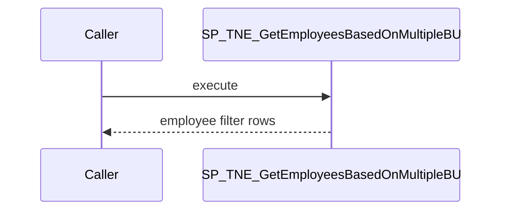
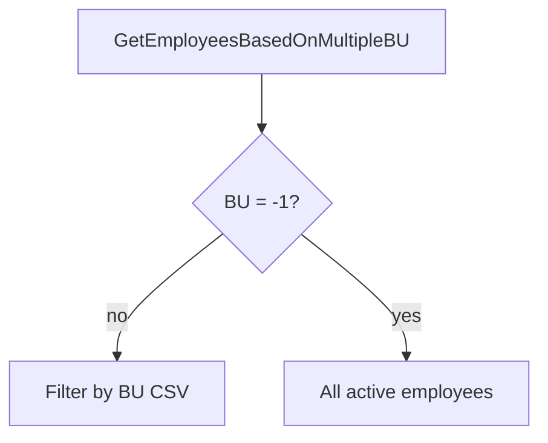

# SP_TNE_GetEmployeesBasedOnMultipleBU

## What it does

Returns active employees (id, employment number, concatenated name) for an employer, optionally filtered to a CSV of business unit ids. Excludes `@EmployeeID` when provided. Distinct from `SP_TNE_GetEmployeesDetailedBasedOnMultipleBU`.

## Parameters

| Name | Direction | What it is for |
|---|---|---|
| `@EmployerID` | in | Employer |
| `@BusinessUnitID` | in | BU CSV, or `-1` for all |
| `@EmployeeID` | in | Employee id to exclude |

## Call sequence

## Callers

App: `ExpenseDAL.GetEmployeesBasedOnMultipleBU` → `ExpenseController.GetEmployeesBasedOnMultipleBU` from [Expense Requests](/docs/guides/expense-and-reimbursement/expense-requests) filters.

## Nested

None.

## Steps

1. Script is `SP_TNE_GetEmployeesBasedOnMultipleBU.sql`.
2. If `@BusinessUnitId != '-1'`, filter `TEmployeeInfo.BusinessUnitId` via `STRING_SPLIT`; else all active employees for employer excluding `@EmployeeID`.

## Tables

| Table | Read or write |
|---|---|
| `TEmployeeInfo` | read (synonym) |
| `TEmployee` | read (synonym, IsActive) |

## Unresolved calls

None.

## Flow

