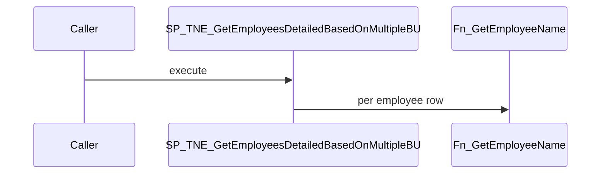
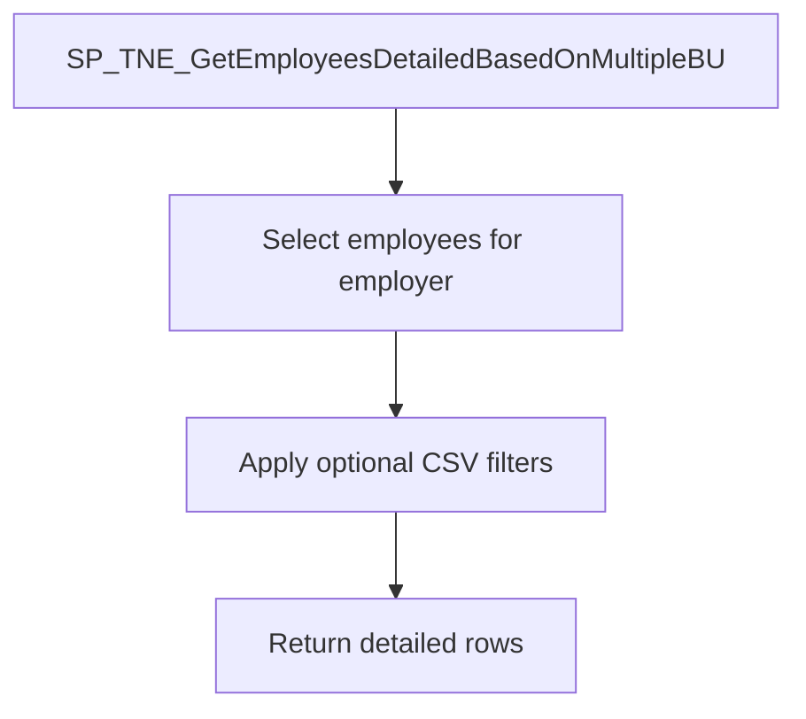

# SP_TNE_GetEmployeesDetailedBasedOnMultipleBU

## What it does

Returns detailed employee rows for one employer filtered by optional CSV lists of business units, designations, grades, locations, work locations, employment types, employees, roles, and grade bands. Filters are AND-combined. Pass null or `-1` to skip a filter.

## Parameters

| Name | Direction | What it is for |
|---|---|---|
| `@EmployerID` | in | Employer context |
| `@BusinessUnitID` | in | CSV of business unit ids, or null/`-1` for all |
| `@EmployeeID` | in | Optional employee id to exclude |
| `@DesignationIds` | in | Optional CSV of designation ids |
| `@GradeIds` | in | Optional CSV of grade ids |
| `@LocationIds` | in | Optional CSV of base location ids |
| `@WorkLocationIds` | in | Optional CSV of work location ids |
| `@EmploymentTypeIds` | in | Optional CSV of employment type ids |
| `@EmployeeIds` | in | Optional CSV of employee ids to include |
| `@RoleIds` | in | Optional CSV of role ids |
| `@GradeBands` | in | Optional CSV of grade bands |

## Call sequence

## Callers

| Object | Kind | Page |
|---|---|---|
| `SP_TNE_PE_GetPolicyEmployees` | procedure | [SP_TNE_PE_GetPolicyEmployees](/docs/database/hrms-travelnexpense/SP_TNE_PE_GetPolicyEmployees) |

`PolicyEngineDAL.GetEmployeesDetailedBasedOnMultipleBU` also executes it from the Policy Engine API.

## Nested

| Object | Kind | When | Page |
|---|---|---|---|
| `Fn_GetEmployeeName` | function | on each selected employee | [Fn_GetEmployeeName](/docs/database/hrms/Fn_GetEmployeeName) |

## Steps

1. In `HRMS-DATABASE/HRMS_TRAVELNEXPENSE/STOREPROCEDURE/SP_TNE_GetEmployeesDetailedBasedOnMultipleBU.sql`, select from employee and employment-info tables for `@EmployerID`.
2. Apply each optional CSV filter with AND logic when the parameter is not null or `-1`.
3. Project employment number, name via `Fn_GetEmployeeName`, business unit, grade, designation, locations, and related labels.

## Tables

| Table | Read or write |
|---|---|
| employee / employment-info tables used by the SELECT | read |
| `TOrgHierarchyDetails` | read |
| `TGrade` | read |
| `TTitle` | read |
| `TLocation` | read |

## Flow

