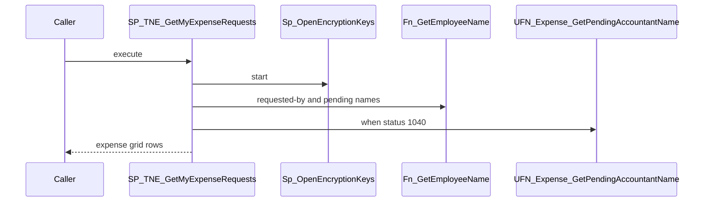
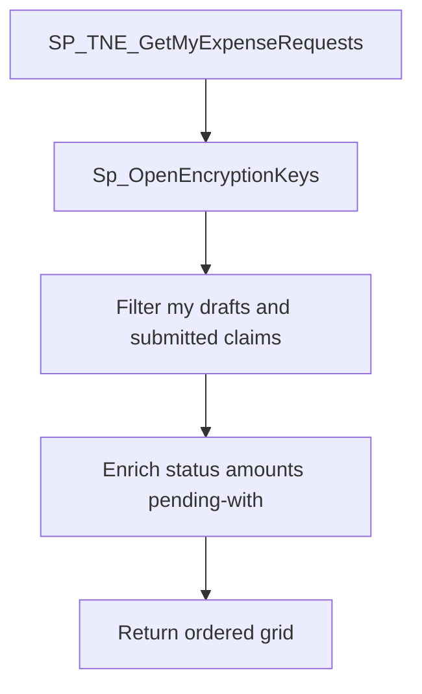

# SP_TNE_GetMyExpenseRequests

## What it does

Returns the My Requests grid for the login user — drafts submitted by the user and submitted claims for the user — filtered by employer CSV, optional employee CSV, request status CSV, and created-on date range. Opens encryption keys, branches on Project Manager role name for some columns, and labels pending accountant via `UFN_Expense_GetPendingAccountantName` when status is 1040.

## Parameters

| Name | Direction | What it is for |
|---|---|---|
| `@LoginUserId` | in | Logged-in employee id (actor) |
| `@pEmployeeId` | in | Employee filter CSV (controller forces actor on tab 1) |
| `@pEmployerId` | in | Employer id CSV |
| `@RequestStatus` | in | Status id CSV or -1 for all |
| `@StartDate` | in | Inclusive created-on start |
| `@EndDate` | in | Inclusive created-on end |

## Call sequence

## Callers

App: `ExpenseDAL.GetExpenseRequestsWithFilters` (`SelectedTab` 1) → `ExpenseController.GetExpenseRequestsWithFilters` from [Expense Requests](/docs/guides/expense-and-reimbursement/expense-requests).

## Nested

| Object | Kind | When | Page |
|---|---|---|---|
| `Sp_OpenEncryptionKeys` | procedure | start of body | [Sp_OpenEncryptionKeys](/docs/database/hrms/Sp_OpenEncryptionKeys) |
| `Fn_GetEmployeeName` | function | requested-by / pending names | [Fn_GetEmployeeName](/docs/database/hrms/Fn_GetEmployeeName) |
| `UFN_Expense_GetPendingAccountantName` | function | status 1040 pending accountant | [UFN_Expense_GetPendingAccountantName](/docs/database/hrms-travelnexpense/UFN_Expense_GetPendingAccountantName) |

## Steps

1. Script is `SP_TNE_GetMyExpenseRequests.sql`.
2. `EXEC Sp_OpenEncryptionKeys`.
3. Split `@pEmployerId` into `#EmployerID`; resolve login role name from `TUserEmployee` / `TUsers` / `TRoles`.
4. Seed `#RRR` from `TEXPENSE` for date/employer scope where draft `SubmittedBy` or submitted `SubmittedFor` is `@LoginUserId`.
5. Build `#ExpenseData` (Project Manager branch vs other), enrich status text, amounts, pending-with, docs/notes, then update stalled/loading/accountant labels.
6. `SELECT` from `#ExpenseData` ordered by AppliedOn, ExpenseId. No `SP_CloseEncryptionKey` in script.

## Tables

| Table | Read or write |
|---|---|
| `TEXPENSE` | read |
| `TEXPENSE_STATUS` | read |
| `TEXPENSE_PAYMENT` | read |
| `TEXPENSE_DOCUMENT` | read |
| `TLOOKUP` | read |
| `TRequestWorkflows` | read |
| `TEMAIL_NOTIFICATION` | read |
| `TEmployee` / `TEmployeeInfo` | read (synonym) |
| `TCountry` | read (currency code) |

## Unresolved calls

None.

## Flow

