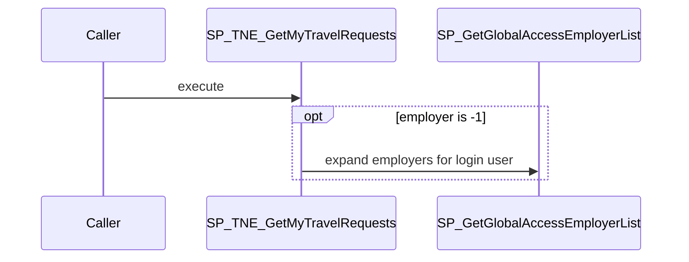
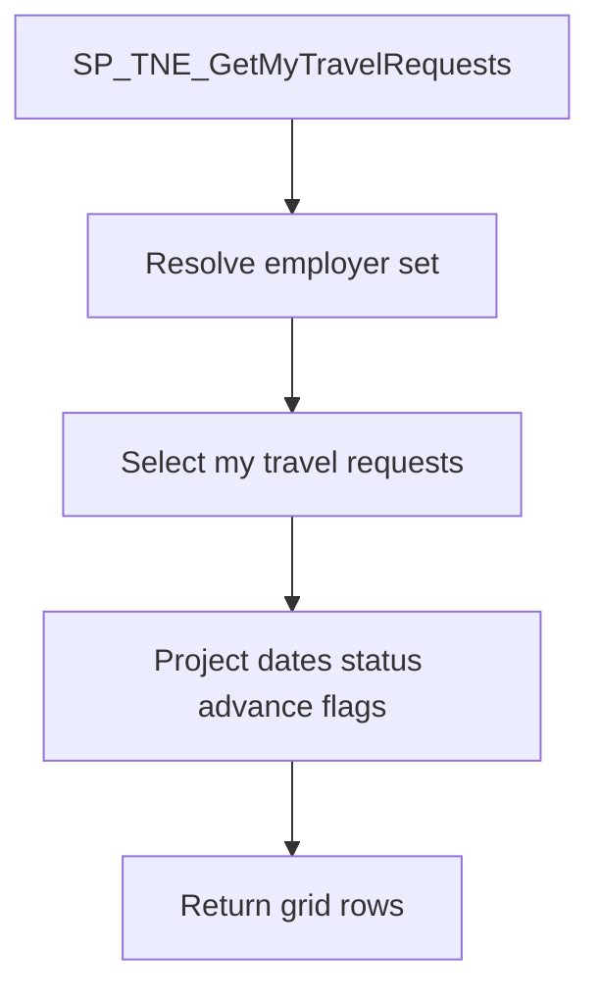

# SP_TNE_GetMyTravelRequests

## What it does

Returns travel request grid rows for the **My Requests** tab: requests where the login user is the submitter (including drafts the user created). Supports employer CSV or global-access employer expansion, status/date/work-type/client filters, and projects schedule dates, advance amount, status labels, and report flags.

## Parameters

| Name | Direction | What it is for |
|---|---|---|
| `@LoginUserId` | in | Actor employee id |
| `@pEmployerId` | in | Employer id, CSV, or `-1` for global access |
| `@RequestStatus` | in | CSV of status lookup ids, or all |
| `@StartDate` | in | Created/travel date window start |
| `@EndDate` | in | Created/travel date window end |
| `@WorkTypeId` | in | Optional work-type filter |
| `@ClientName` | in | Optional client-name filter |

## Call sequence

## Callers

| Caller | Page |
|---|---|
| `TravelDAL.GetTravelRequestsWithFilters` when `SelectedTab == 1` | Travel Requests guide |

## Nested

| Object | Kind | When | Page |
|---|---|---|---|
| `SP_GetGlobalAccessEmployerList` | procedure | `@pEmployerId = '-1'` | [SP_GetGlobalAccessEmployerList](/docs/database/hrms/SP_GetGlobalAccessEmployerList) |

## Steps

1. Resolve `#EmployerID` from CSV, single id, or `SP_GetGlobalAccessEmployerList`.
2. Select from `TTRAVEL_REQUEST` for the login user with status/date/work-type/client filters.
3. Project type/purpose labels from `TLOOKUP`, schedule from/to dates from live `TTRAVEL_SCHEDULE` rows, advance amount, latest status text, notes/docs counts, and travel-report flags.

## Tables

| Table | Read or write |
|---|---|
| `TTRAVEL_REQUEST` | read |
| `TTRAVEL_SCHEDULE` | read |
| `TTRAVEL_REQ_STATUS` | read |
| `TTRAVEL_REQ_ADVANCE` | read |
| `TLOOKUP` | read |
| `TEMPLOYEE` / `TEmployeeInfo` / `TOrgHierarchyDetails` | read |
| `TTRAVEL_COMMENT` / `TTRAVEL_DOCUMENT` | read |
| `TTRAVEL_REPORTSAPPROVAL` / `TNE_TravelReportStatus` | read |

## Unresolved calls

None beyond the nested procedure above.

## Flow

