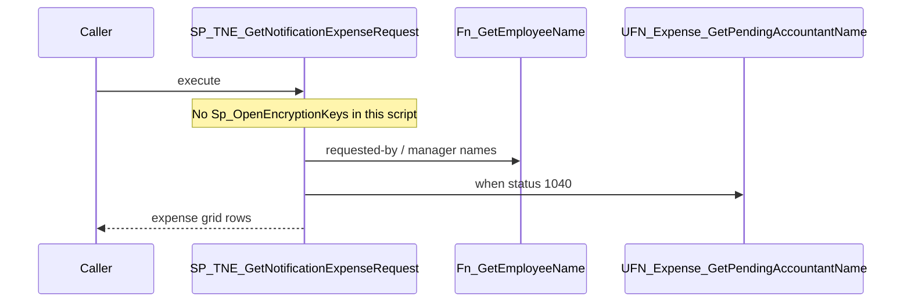
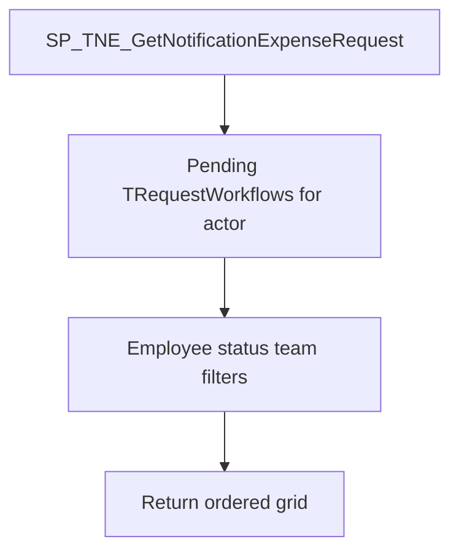

# SP_TNE_GetNotificationExpenseRequest

## What it does

Returns Notification tab claims pending with the login user in `TRequestWorkflows` (`ApproveStatus = P`) for expense request types, optionally limited to team members when `@IsTeamMember = 1`. Does not call `Sp_OpenEncryptionKeys` in the script body.

## Parameters

| Name | Direction | What it is for |
|---|---|---|
| `@LoginUserId` | in | Approver employee id |
| `@pEmployerId` | in | Employer id CSV |
| `@RequestStatus` | in | Status filter CSV |
| `@pEmployeeId` | in | Employee filter CSV |
| `@IsTeamMember` | in | When 1, restrict to functional/reporting team |

## Call sequence

## Callers

App: `ExpenseDAL.GetExpenseRequestsWithFilters` (`SelectedTab` 5) → `ExpenseController.GetExpenseRequestsWithFilters` from [Expense Requests](/docs/guides/expense-and-reimbursement/expense-requests).

## Nested

| Object | Kind | When | Page |
|---|---|---|---|
| `Fn_GetEmployeeName` | function | requested-by / manager names | [Fn_GetEmployeeName](/docs/database/hrms/Fn_GetEmployeeName) |
| `UFN_Expense_GetPendingAccountantName` | function | status 1040 pending accountant | [UFN_Expense_GetPendingAccountantName](/docs/database/hrms-travelnexpense/UFN_Expense_GetPendingAccountantName) |

## Steps

1. Script is `SP_TNE_GetNotificationExpenseRequest.sql`.
2. Split employers; resolve role name.
3. Seed `#RRR` from `TEXPENSE` where a pending `TRequestWorkflows` row exists for the login manager and expense request types.
4. Build `#ExpenseData`; apply filters including optional team-member restriction; accountant labels; return grid.

## Tables

| Table | Read or write |
|---|---|
| `TEXPENSE` | read |
| `TEXPENSE_STATUS` | read |
| `TEXPENSE_PAYMENT` | read |
| `TEXPENSE_DOCUMENT` | read |
| `TLOOKUP` | read |
| `TRequestWorkflows` | read |
| `TEMAIL_NOTIFICATION` | read |
| `TEmployee` / `TEmployeeInfo` | read (synonym) |

## Unresolved calls

Uses `Fn_GetEmployeeName` without an `Sp_OpenEncryptionKeys` call in this procedure.

## Flow

