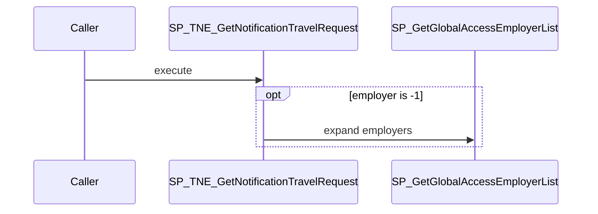
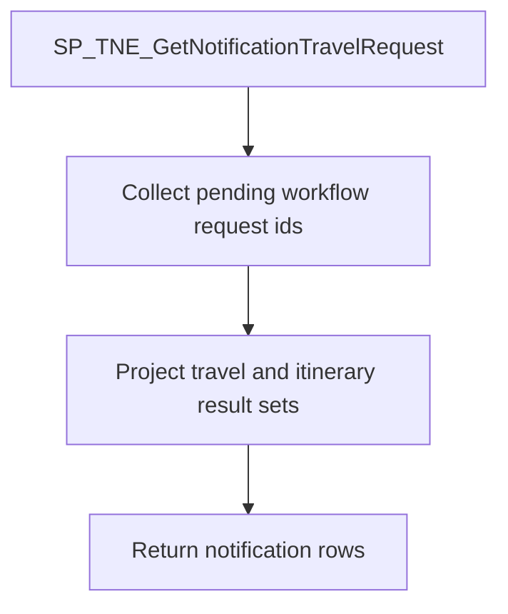

# SP_TNE_GetNotificationTravelRequest

## What it does

Builds the Notifications inbox for pending **travel** and **itinerary** approvals for `@pEmployeeId`. Pre-filters `TRequestWorkflows` rows where the actor is manager with ApproveStatus `P`, then projects travel-request grid columns. Returns multiple result sets consumed by `TravelDAL.GetNotificationTravelRequests`.

## Parameters

| Name | Direction | What it is for |
|---|---|---|
| `@pEmployerId` | in | Employer id, CSV, or `-1` |
| `@pEmployeeId` | in | Approver employee id |
| `@showInactiveEmployees` | in | Include inactive employees when 1 |

## Call sequence

## Callers

| Caller | Page |
|---|---|
| `TravelDAL.GetNotificationTravelRequests` | Travel Requests guide |

## Nested

| Object | Kind | When | Page |
|---|---|---|---|
| `SP_GetGlobalAccessEmployerList` | procedure | `@pEmployerId = '-1'` | [SP_GetGlobalAccessEmployerList](/docs/database/hrms/SP_GetGlobalAccessEmployerList) |

## Steps

1. Resolve employer set and active/inactive filter.
2. Insert approver-related `TravelRequestId` values from pending `TRequestWorkflows` (header and line, including reschedule children).
3. Select matching `TTRAVEL_REQUEST` rows and project list columns into result sets for pending travel vs itinerary.

## Tables

| Table | Read or write |
|---|---|
| `TRequestWorkflows` | read |
| `TTRAVEL_REQUEST` | read |
| `TTRAVEL_SCHEDULE` | read |
| `TTRAVEL_REQ_STATUS` | read |
| `TLOOKUP` | read |
| `TEMPLOYEE` / `TEmployeeInfo` | read |

## Unresolved calls

None beyond the nested procedure above.

## Flow

