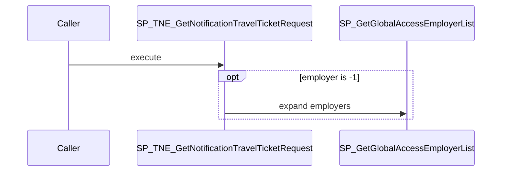
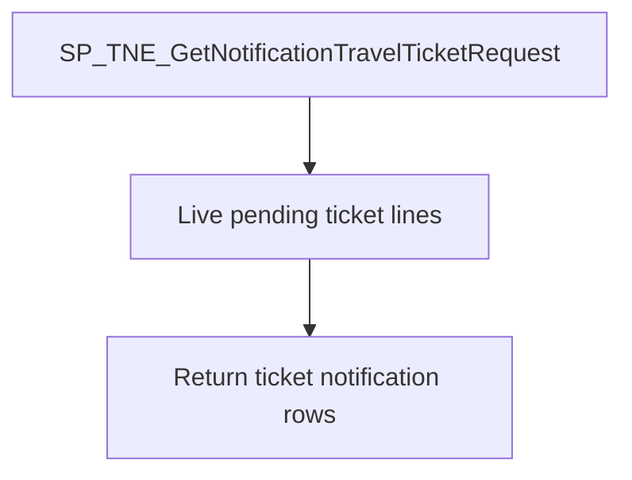

# SP_TNE_GetNotificationTravelTicketRequest

## What it does

Notifications inbox for pending **ticket booking / ticket uploaded** work (travel desk). Lists live schedule/accommodation lines awaiting ticket actions; ignores archived/cancelled (rescheduled) lines per procedure comments.

## Parameters

| Name | Direction | What it is for |
|---|---|---|
| `@pEmployerId` | in | Employer id, CSV, or `-1` |
| `@pEmployeeId` | in | Actor employee id |
| `@showInactiveEmployees` | in | Include inactive employees when 1 |

## Call sequence

## Callers

| Caller | Page |
|---|---|
| `TravelDAL.GetNotificationTravelRequests` (ticket result set) | Travel Requests guide |

## Nested

| Object | Kind | When | Page |
|---|---|---|---|
| `SP_GetGlobalAccessEmployerList` | procedure | `@pEmployerId = '-1'` | [SP_GetGlobalAccessEmployerList](/docs/database/hrms/SP_GetGlobalAccessEmployerList) |

## Steps

1. Resolve employer set and active/inactive filter.
2. Select pending ticket-booking / ticket-upload notification rows for live schedule and accommodation lines.
3. Project travel list columns including round-trip `TravelToDate` from live return schedule dates.

## Tables

| Table | Read or write |
|---|---|
| `TTRAVEL_REQUEST` | read |
| `TTRAVEL_SCHEDULE` | read |
| travel accommodation / itinerary status tables used in script | read |
| `TLOOKUP` | read |
| `TEMPLOYEE` | read |

## Unresolved calls

None beyond the nested procedure above.

## Flow

