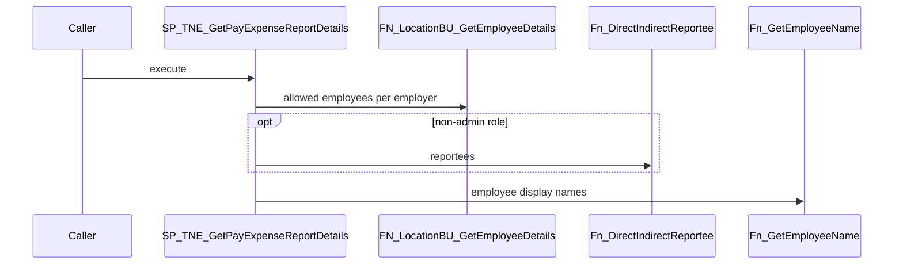
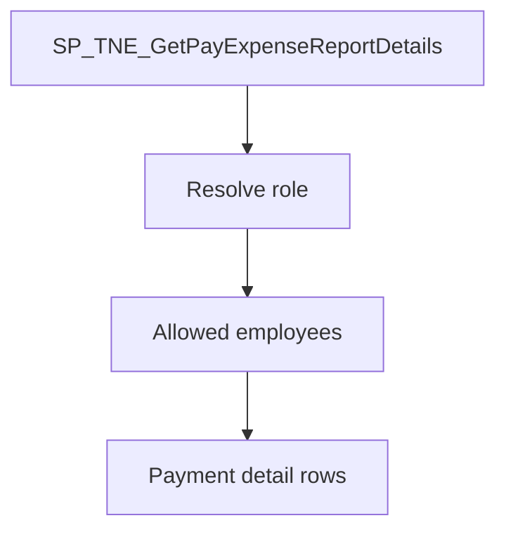

# SP_TNE_GetPayExpenseReportDetails

## What it does

Builds the **Pay Expenses** report. Resolves the actor role, builds an allowed-employee set via location-BU (and direct/indirect reportees for non-admin roles), reads `VE_TNE_ExpenseDetails` with status/date filters, resolves employee names/org/bank fields, and returns payment-oriented rows.

## Parameters

| Name | Direction | What it is for |
|---|---|---|
| `@EmployerID` | in | Employer id or CSV |
| `@EmployeeID` | in | Actor employee |
| `@pv_FromDate` / `@pv_ToDate` | in | Created-on window |
| `@pv_Status` | in | Status CSV |
| `@ViewType` | in | View character used with role logic |

## Call sequence

## Callers

| Caller | Page |
|---|---|
| `ReportsDAL.GetPayExpenseReportData` | [Report](/docs/guides/expense-and-reimbursement/report) |

## Nested

| Object | Kind | When | Page |
|---|---|---|---|
| `FN_LocationBU_GetEmployeeDetails` | function | allowed employee set | [FN_LocationBU_GetEmployeeDetails](/docs/database/hrms/FN_LocationBU_GetEmployeeDetails) |
| `Fn_DirectIndirectReportee` | function | manager scope | [Fn_DirectIndirectReportee](/docs/database/hrms/Fn_DirectIndirectReportee) |
| `Fn_GetEmployeeName` | function | display name update | [Fn_GetEmployeeName](/docs/database/hrms/Fn_GetEmployeeName) |

## Steps

1. Resolve actor role from `TUserEmployee` / `TUsers` / `TRoles`.
2. Cursor employers and fill allowed employees via `FN_LocationBU_GetEmployeeDetails`.
3. Build employee temp set (admin vs reportee paths).
4. Load payment details from `VE_TNE_ExpenseDetails`, enrich name/org/bank, return.

## Tables

| Table | Read or write |
|---|---|
| `VE_TNE_ExpenseDetails` | read |
| `TEXPENSE_STATUS` / `TEXPENSE_PAYMENT` | read |
| `TEMPLOYEE` / `TEmployeeInfo` / `TOrgHierarchyDetails` | read |
| `TUserEmployee` / `TUsers` / `TRoles` | read |
| `TEmployeeBankDetails` / `TBankBranchDetails` / `TAccountType` | read |
| `TEmployerDetails` / `TCountry` | read |

## Unresolved calls

None beyond nested functions above.

## Flow

