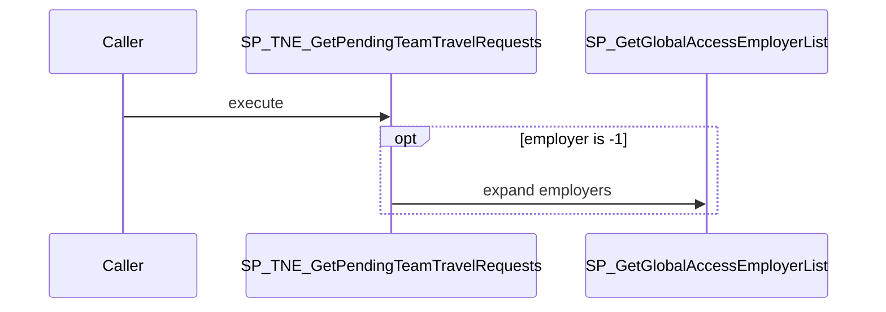
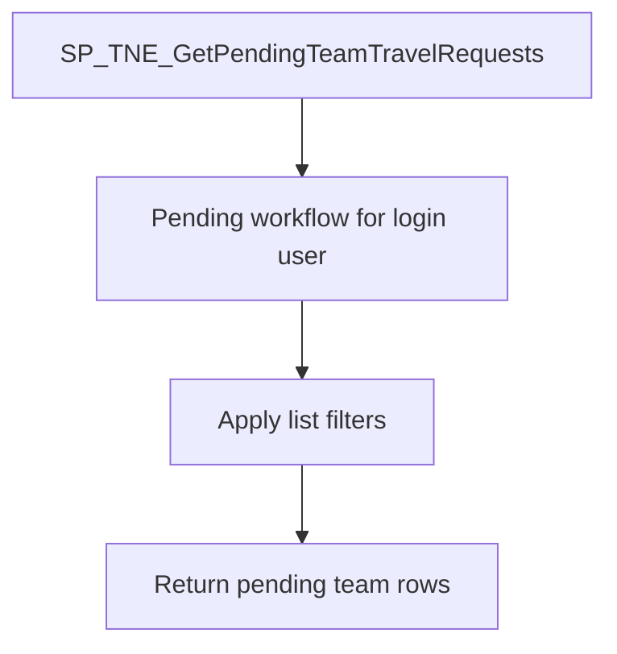

# SP_TNE_GetPendingTeamTravelRequests

## What it does

Returns team travel requests that are pending for the login user as approver (Team Requests “pending for me” / `SelectedTab == 5`). Filters by employer, employee, status, dates, work type, and client; supports inactive employees.

## Parameters

| Name | Direction | What it is for |
|---|---|---|
| `@pEmployerId` | in | Employer id, CSV, or `-1` |
| `@LoginUserId` | in | Approver / actor employee id |
| `@pEmployeeId` | in | CSV of employee ids to filter |
| `@RequestStatus` | in | CSV of status lookup ids |
| `@StartDate` | in | Date window start |
| `@EndDate` | in | Date window end |
| `@showInactiveEmployees` | in | Include inactive employees when 1 |
| `@WorkTypeId` | in | Optional work-type filter |
| `@ClientName` | in | Optional client-name filter |

## Call sequence

## Callers

| Caller | Page |
|---|---|
| `TravelDAL.GetTravelRequestsWithFilters` when `SelectedTab == 5` | Travel Requests guide |

## Nested

| Object | Kind | When | Page |
|---|---|---|---|
| `SP_GetGlobalAccessEmployerList` | procedure | `@pEmployerId = '-1'` | [SP_GetGlobalAccessEmployerList](/docs/database/hrms/SP_GetGlobalAccessEmployerList) |

## Steps

1. Resolve employer set and active/inactive filter.
2. Restrict to requests where `@LoginUserId` has pending workflow involvement for team scope.
3. Apply filters and project standard travel list columns.

## Tables

| Table | Read or write |
|---|---|
| `TTRAVEL_REQUEST` | read |
| `TRequestWorkflows` | read |
| `TTRAVEL_SCHEDULE` | read |
| `TTRAVEL_REQ_STATUS` | read |
| `TLOOKUP` | read |
| `TEMPLOYEE` / `TEmployeeInfo` | read |

## Unresolved calls

None beyond the nested procedure above.

## Flow

