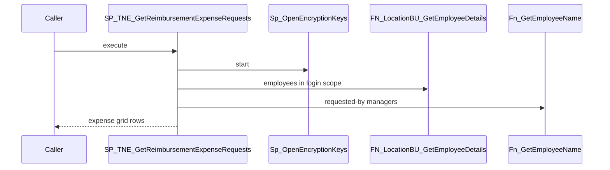
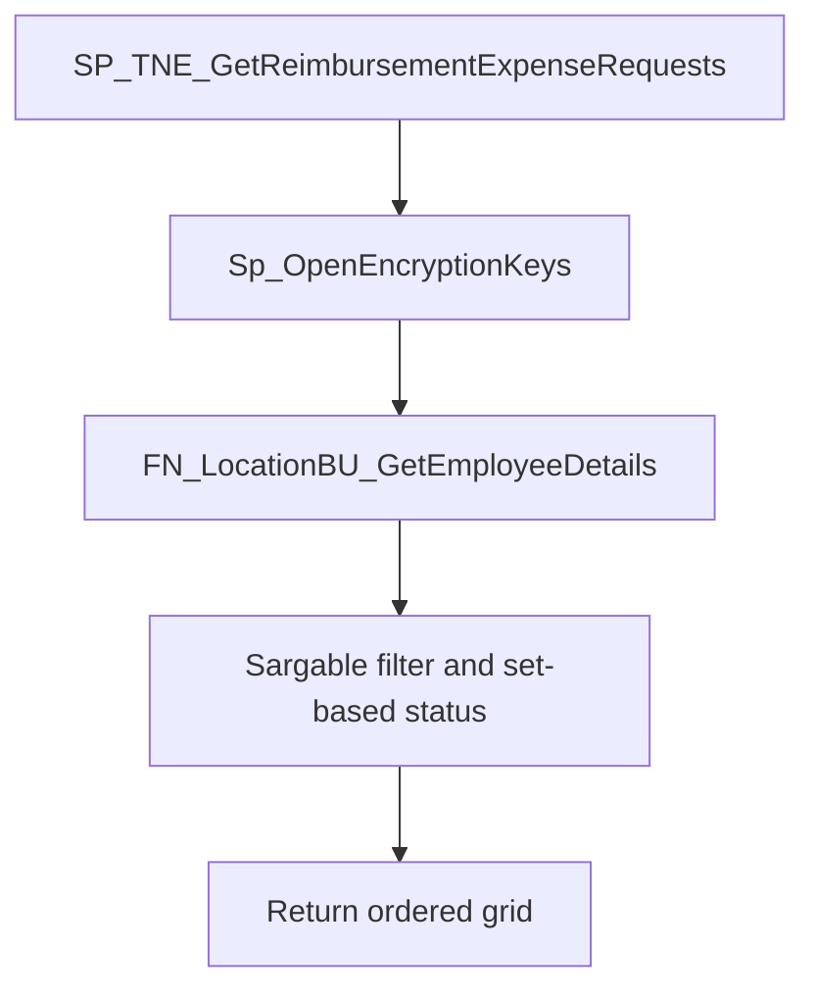

# SP_TNE_GetReimbursementExpenseRequests

## What it does

Returns Reimbursement Requests for accountants/viewers. Uses sargable date bounds, set-based latest status, and scopes claims to employees from `FN_LocationBU_GetEmployeeDetails(@LoginUserId, NULL)`.

## Parameters

| Name | Direction | What it is for |
|---|---|---|
| `@LoginUserId` | in | Logged-in user id for location/BU scope |
| `@pEmployeeId` | in | Employee filter CSV or -1 |
| `@pEmployerId` | in | Employer id CSV |
| `@RequestStatus` | in | Status id CSV or -1 |
| `@StartDate` | in | Created-on start |
| `@EndDate` | in | Created-on end |
| `@BusinessUnit` | in | Business unit CSV or -1 |

## Call sequence

## Callers

App: `ExpenseDAL.GetExpenseRequestsWithFilters` (`SelectedTab` 4) → `ExpenseController.GetExpenseRequestsWithFilters` from [Expense Requests](/docs/guides/expense-and-reimbursement/expense-requests).

## Nested

| Object | Kind | When | Page |
|---|---|---|---|
| `Sp_OpenEncryptionKeys` | procedure | start of body | [Sp_OpenEncryptionKeys](/docs/database/hrms/Sp_OpenEncryptionKeys) |
| `FN_LocationBU_GetEmployeeDetails` | function | scope employees for login user | [FN_LocationBU_GetEmployeeDetails](/docs/database/hrms-travelnexpense/FN_LocationBU_GetEmployeeDetails) |
| `Fn_GetEmployeeName` | function | requested-by / managers | [Fn_GetEmployeeName](/docs/database/hrms/Fn_GetEmployeeName) |
| `UFN_Expense_GetPendingAccountantName` | function | status 1040 pending accountant | [UFN_Expense_GetPendingAccountantName](/docs/database/hrms-travelnexpense/UFN_Expense_GetPendingAccountantName) |

## Steps

1. Script is `SP_TNE_GetReimbursementExpenseRequests.sql` (includes Nov 2026 performance changes).
2. Open encryption keys; build filter temp tables for employer/employee/BU/status.
3. Scope via `FN_LocationBU_GetEmployeeDetails`; load submitted `#RRR` with sargable date range.
4. Compute latest status set-based; enrich names/payments/docs; return grid.

## Tables

| Table | Read or write |
|---|---|
| `TEXPENSE` | read |
| `TEXPENSE_STATUS` | read |
| `TEXPENSE_PAYMENT` | read |
| `TEXPENSE_DOCUMENT` | read |
| `TLOOKUP` | read |
| `TRequestWorkflows` | read |
| `TEmployee` / `TEmployeeInfo` | read (synonym) |

## Unresolved calls

None.

## Flow

