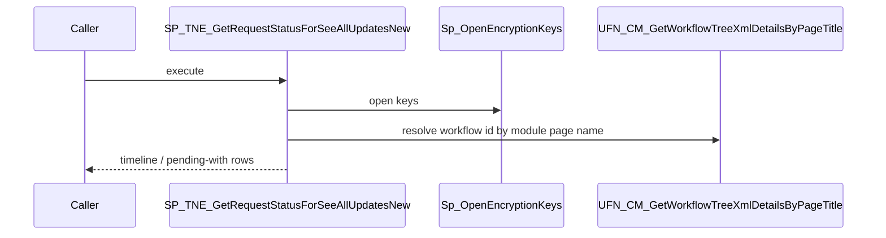
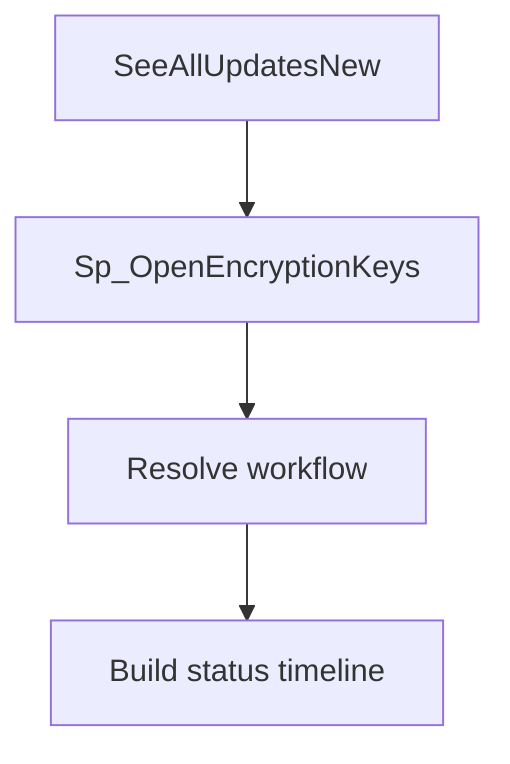

# SP_TNE_GetRequestStatusForSeeAllUpdatesNew

## What it does

Builds the See All Updates status timeline for one expense request — status history, pending-with names, workflow levels, and accountant-config skip flags. Both DAL methods `GetRequestStatusForSeeAllUpdates` and `GetRequestStatusForSeeAllUpdatesNew` execute this procedure name.

## Parameters

| Name | Direction | What it is for |
|---|---|---|
| `@pExpenseRequestId` | in | Expense id |
| `@pEmployerId` | in | Employer |

## Call sequence

## Callers

App: `ExpenseDAL.GetRequestStatusForSeeAllUpdates` / `GetRequestStatusForSeeAllUpdatesNew` → matching `ExpenseController` actions from [Expense Requests](/docs/guides/expense-and-reimbursement/expense-requests) See All Updates.

## Nested

| Object | Kind | When | Page |
|---|---|---|---|
| `Sp_OpenEncryptionKeys` | procedure | start | [Sp_OpenEncryptionKeys](/docs/database/hrms/Sp_OpenEncryptionKeys) |
| `UFN_CM_GetWorkflowTreeXmlDetailsByPageTitle` | function | resolve workflow | [UFN_CM_GetWorkflowTreeXmlDetailsByPageTitle](/docs/database/hrms/UFN_CM_GetWorkflowTreeXmlDetailsByPageTitle) |

## Steps

1. Script is `SP_TNE_GetRequestStatusForSeeAllUpdatesNew.sql`.
2. Open encryption keys; load claim and accountant JSON config; read `TTNEEmployerConfiguration` skip flags.
3. Resolve module page name from `TEMAIL_NOTIFICATION`; compute workflow levels from `TWorkflowDetails` / `TRequestWorkflows` and `UFN_CM_GetWorkflowTreeXmlDetailsByPageTitle`.
4. Assemble timeline result sets for the UI (large body; includes reassignment-related history notes in change log).

## Tables

| Table | Read or write |
|---|---|
| `TEXPENSE` | read |
| `TEXPENSE_STATUS` | read |
| `TEMAIL_NOTIFICATION` | read |
| `TTNEEmployerConfiguration` | read |
| `TWorkflowDetails` / `TWorkflowManagement` | read |
| `TRequestWorkflows` | read |

## Unresolved calls

Other helper functions inside the large body may exist beyond the nested objects listed; skim focused on encryption open and workflow UFN.

## Flow

