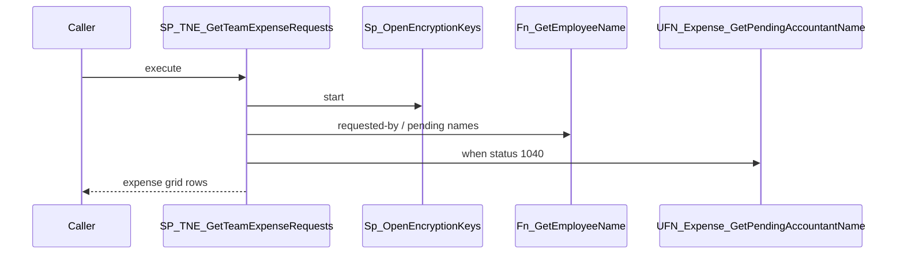
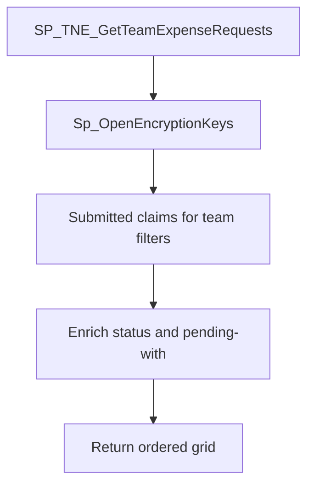

# SP_TNE_GetTeamExpenseRequests

## What it does

Returns submitted team expense claims for managers, filtered by employer, employee, business unit, status, and date range. Same encryption/name/accountant enrichment pattern as My Requests, with `@BusinessUnit` filter.

## Parameters

| Name | Direction | What it is for |
|---|---|---|
| `@LoginUserId` | in | Logged-in manager id |
| `@pEmployeeId` | in | Employee filter CSV |
| `@pEmployerId` | in | Employer id CSV |
| `@RequestStatus` | in | Status id CSV |
| `@StartDate` | in | Inclusive created-on start |
| `@EndDate` | in | Inclusive created-on end |
| `@BusinessUnit` | in | Business unit id CSV or -1 |

## Call sequence

## Callers

App: `ExpenseDAL.GetExpenseRequestsWithFilters` (`SelectedTab` 2) → `ExpenseController.GetExpenseRequestsWithFilters` from [Expense Requests](/docs/guides/expense-and-reimbursement/expense-requests).

## Nested

| Object | Kind | When | Page |
|---|---|---|---|
| `Sp_OpenEncryptionKeys` | procedure | start of body | [Sp_OpenEncryptionKeys](/docs/database/hrms/Sp_OpenEncryptionKeys) |
| `Fn_GetEmployeeName` | function | requested-by / pending names | [Fn_GetEmployeeName](/docs/database/hrms/Fn_GetEmployeeName) |
| `UFN_Expense_GetPendingAccountantName` | function | status 1040 pending accountant | [UFN_Expense_GetPendingAccountantName](/docs/database/hrms-travelnexpense/UFN_Expense_GetPendingAccountantName) |

## Steps

1. Script is `SP_TNE_GetTeamExpenseRequests.sql`.
2. Open encryption keys; split employers; resolve role name.
3. Seed submitted `TEXPENSE` rows into `#RRR` for employer/date scope.
4. Insert `#ExpenseData` with Project Manager branch; apply employee/BU/status filters in the outer query.
5. Update pending-with / accountant labels; return ordered rows. No close-encryption call.

## Tables

| Table | Read or write |
|---|---|
| `TEXPENSE` | read |
| `TEXPENSE_STATUS` | read |
| `TEXPENSE_PAYMENT` | read |
| `TEXPENSE_DOCUMENT` | read |
| `TLOOKUP` | read |
| `TRequestWorkflows` | read |
| `TEMAIL_NOTIFICATION` | read |
| `TEmployee` / `TEmployeeInfo` | read (synonym) |
| `TOrgHierarchyDetails` | read (business unit name) |

## Unresolved calls

None.

## Flow

