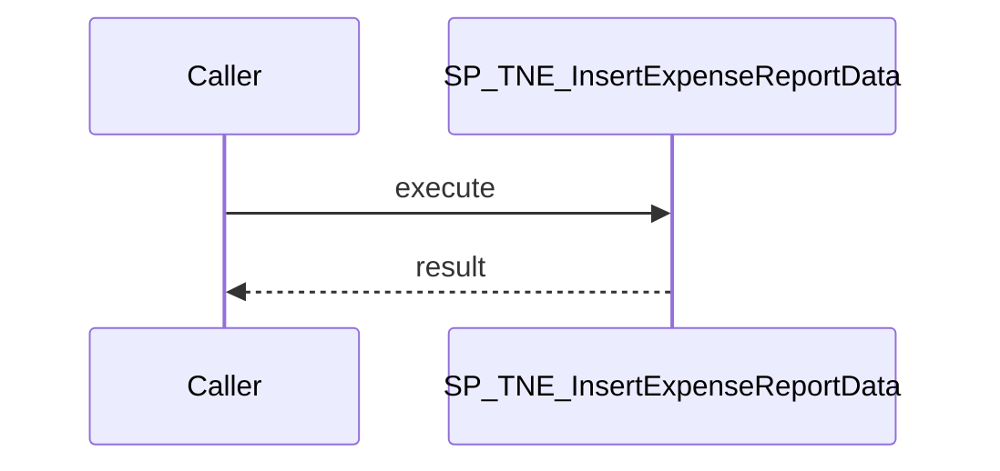
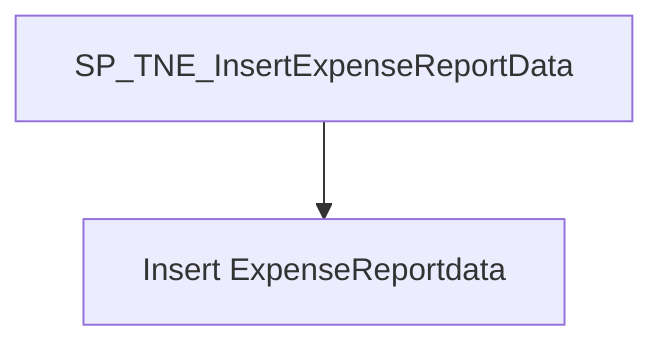

# SP_TNE_InsertExpenseReportData

## What it does

Inserts one row into `ExpenseReportdata` for a new managed/saved expense report (name, share list, selected fields, filter JSON, description).

## Parameters

| Name | Direction | What it is for |
|---|---|---|
| `@ReportName` | in | Report title |
| `@EmployeeID` | in | Owner employee |
| `@EmployerID` | in | Employer |
| `@Sharedwith` | in | Share list (`-1` = org) |
| `@Fields` | in | Selected column list |
| `@Filter_Json` | in | Serialized search filters |
| `@Createdby` | in | Creating employee |
| `@Description` | in | Description text |

## Call sequence

## Callers

| Caller | Page |
|---|---|
| `ReportsDAL.AddExpenseSavedReportData` | [Report](/docs/guides/expense-and-reimbursement/report) |

## Nested

Calls no other procedures or functions.

## Steps

1. Insert into `ExpenseReportdata` with `CreatedDate = GETDATE()`.

## Tables

| Table | Read or write |
|---|---|
| `ExpenseReportdata` | write |

## Unresolved calls

None.

## Flow

