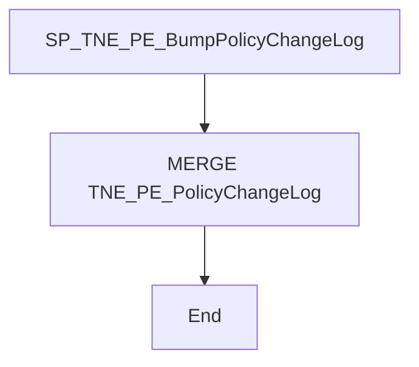

# SP_TNE_PE_BumpPolicyChangeLog

## What it does

Merges one row in `TNE_PE_PolicyChangeLog` for an employer, module, and policy type. Callers use it after a successful policy create, update, delete, resolution-strategy change, specificity-weight change, or type-registry sync so evaluation cache rows can self-invalidate on the next read.

## Parameters

| Name | Direction | What it is for |
|---|---|---|
| `@EmployerId` | in | Employer scope |
| `@ModuleKey` | in | Module such as `expense` or `advance` |
| `@PolicyTypeKey` | in | Policy type such as `eligibility` or `limit` |
| `@ChangedBy` | in | Optional short reason string stored on the row |

## Call sequence

Calls no other procedures or functions.

## Callers

| Object | Kind | Page |
|---|---|---|
| `SP_TNE_PE_CreatePolicy` | procedure | [SP_TNE_PE_CreatePolicy](/docs/database/hrms-travelnexpense/SP_TNE_PE_CreatePolicy) |
| `SP_TNE_PE_UpdatePolicy` | procedure | [SP_TNE_PE_UpdatePolicy](/docs/database/hrms-travelnexpense/SP_TNE_PE_UpdatePolicy) |
| `SP_TNE_PE_DeletePolicy` | procedure | [SP_TNE_PE_DeletePolicy](/docs/database/hrms-travelnexpense/SP_TNE_PE_DeletePolicy) |
| `SP_TNE_PE_UpdateResolutionStrategy` | procedure | [SP_TNE_PE_UpdateResolutionStrategy](/docs/database/hrms-travelnexpense/SP_TNE_PE_UpdateResolutionStrategy) |
| `SP_TNE_PE_UpdateSpecificityWeights` | procedure | [SP_TNE_PE_UpdateSpecificityWeights](/docs/database/hrms-travelnexpense/SP_TNE_PE_UpdateSpecificityWeights) |
| `SP_TNE_SyncTypeRegistry` | procedure | No page yet |

## Nested

Calls no other procedures or functions.

## Steps

1. In `HRMS-DATABASE/HRMS_TRAVELNEXPENSE/STOREPROCEDURE/SP_TNE_PE_BumpPolicyChangeLog.sql`, MERGE `TNE_PE_PolicyChangeLog` on `(EmployerId, ModuleKey, PolicyTypeKey)`.
2. When matched, set `LastChangedAt = SYSUTCDATETIME()` and `ChangedBy = @ChangedBy`.
3. When not matched, insert that key with the same timestamp and `ChangedBy`.

## Tables

| Table | Read or write |
|---|---|
| `TNE_PE_PolicyChangeLog` | write |

## Flow

