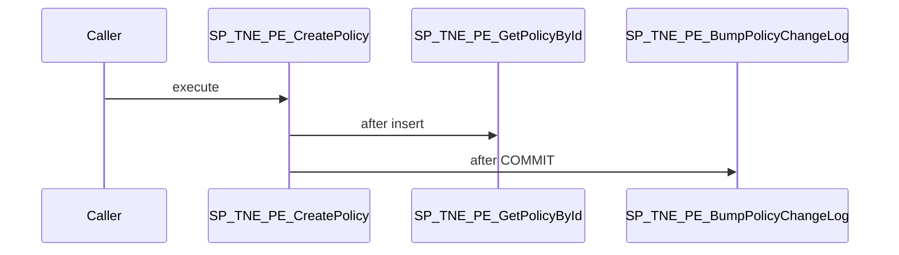
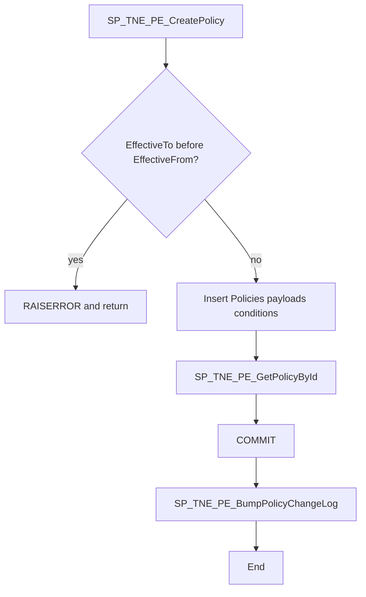

# SP_TNE_PE_CreatePolicy

## What it does

Inserts a new policy header, one or more payloads (including normalized limit or eligibility rows), conditions from JSON, and a history snapshot. After commit it returns the new policy via `SP_TNE_PE_GetPolicyById` and bumps `TNE_PE_PolicyChangeLog`.

## Parameters

| Name | Direction | What it is for |
|---|---|---|
| `@ModuleKey` | in | Module |
| `@PolicyTypeKey` | in | Policy type |
| `@PolicyName` | in | Display name |
| `@PolicyDescription` | in | Optional description |
| `@Priority` | in | Priority, default 0 |
| `@Strict` | in | Strict flag |
| `@EffectiveFrom` | in | Start date |
| `@EffectiveTo` | in | End date |
| `@EmployerId` | in | Optional employer |
| `@ExpenseTypeId` | in | Optional type id for single-payload path |
| `@SubExpenseTypeIdsJson` | in | Optional subtype JSON |
| `@PayloadValue` | in | Optional enable/disable value |
| `@LimitAmount` | in | Optional limit amount |
| `@LimitPeriod` | in | Optional limit period |
| `@LimitUnit` | in | Optional limit unit |
| `@PayloadsJson` | in | Preferred multi-row payload JSON for limits |
| `@ConditionsJson` | in | Conditions JSON array |
| `@CreatedBy` | in | Actor employee id |
| `@SubmissionRule` | in | Optional submission rule JSON |
| `@SubmissionRuleEnable` | in | Whether submission rule is on |
| `@PolicyId` | out | New policy id |

## Call sequence

## Callers

No other procedure or function calls this object. `PolicyEngineDAL.CreatePolicy` executes it from the Policy Engine API.

## Nested

| Object | Kind | When | Page |
|---|---|---|---|
| `SP_TNE_PE_GetPolicyById` | procedure | after the insert succeeds | [SP_TNE_PE_GetPolicyById](/docs/database/hrms-travelnexpense/SP_TNE_PE_GetPolicyById) |
| `SP_TNE_PE_BumpPolicyChangeLog` | procedure | after COMMIT | [SP_TNE_PE_BumpPolicyChangeLog](/docs/database/hrms-travelnexpense/SP_TNE_PE_BumpPolicyChangeLog) |

## Steps

1. In `HRMS-DATABASE/HRMS_TRAVELNEXPENSE/STOREPROCEDURE/SP_TNE_PE_CreatePolicy.sql`, reject when `@EffectiveTo` is earlier than `@EffectiveFrom`.
2. Begin a transaction when none is open and insert `Policies`.
3. Insert `PolicyPayloads` and, for limit or eligibility shapes, normalized payload tables from `@PayloadsJson` or the single-payload parameters.
4. Insert `PolicyConditions` from `@ConditionsJson`.
5. Write a history row, then execute `SP_TNE_PE_GetPolicyById`.
6. Commit, then execute `SP_TNE_PE_BumpPolicyChangeLog` for the employer, module, and policy type.

## Tables

| Table | Read or write |
|---|---|
| `Policies` | write |
| `PolicyPayloads` | write |
| `PolicyConditions` | write |
| `TNE_PE_PolicyLimitPayload` | write |
| `TNE_PE_PolicyEligibilityPayload` | write |
| policy history tables used by the insert | write |

## Unresolved calls

Dynamic `sp_executesql` appears in the script for part of the create path.

## Flow

