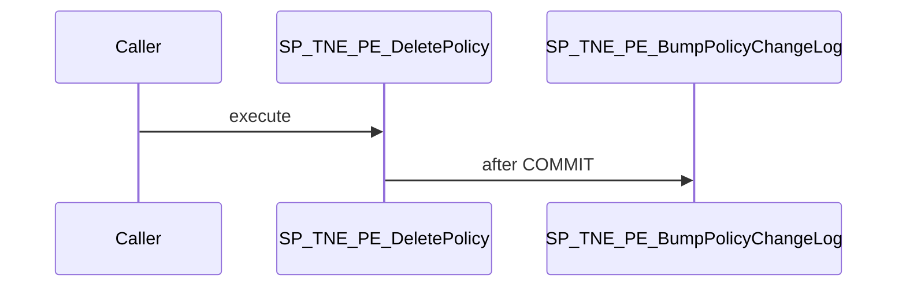
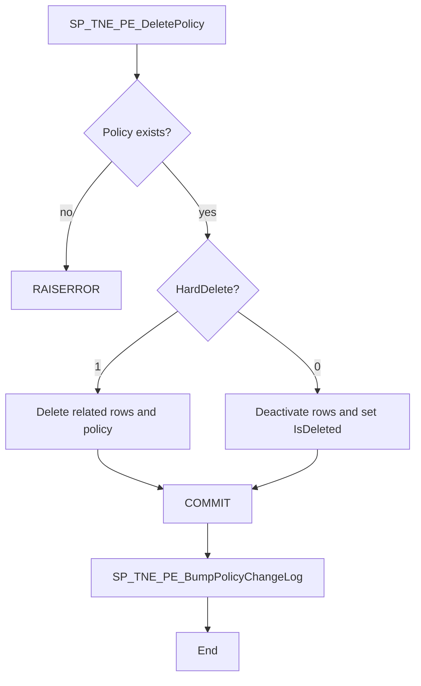

# SP_TNE_PE_DeletePolicy

## What it does

Deletes a policy. Soft delete (default) marks conditions and payloads inactive and sets `Policies.IsDeleted`. Hard delete permanently removes conditions, payloads, and the policy row. After commit it bumps `TNE_PE_PolicyChangeLog` for the policy's employer, module, and type.

## Parameters

| Name | Direction | What it is for |
|---|---|---|
| `@PolicyId` | in | Policy to delete |
| `@DeletedBy` | in | Actor employee id |
| `@HardDelete` | in | 0 soft delete (default), 1 hard delete |

## Call sequence

## Callers

No other procedure or function calls this object. `PolicyEngineDAL.DeletePolicy` executes it from the Policy Engine API.

## Nested

| Object | Kind | When | Page |
|---|---|---|---|
| `SP_TNE_PE_BumpPolicyChangeLog` | procedure | after COMMIT | [SP_TNE_PE_BumpPolicyChangeLog](/docs/database/hrms-travelnexpense/SP_TNE_PE_BumpPolicyChangeLog) |

## Steps

1. In `HRMS-DATABASE/HRMS_TRAVELNEXPENSE/STOREPROCEDURE/SP_TNE_PE_DeletePolicy.sql`, raise an error when the policy is missing, or when soft-deleting an already deleted policy.
2. Capture employer, module, and policy type for the change-log bump.
3. Soft path: deactivate conditions and payloads, then mark the policy deleted and inactive.
4. Hard path: delete conditions, payloads, and the policy row.
5. Commit, then execute `SP_TNE_PE_BumpPolicyChangeLog`.

## Tables

| Table | Read or write |
|---|---|
| `Policies` | read then write or delete |
| `PolicyConditions` | write or delete |
| `PolicyPayloads` | write or delete |

## Flow

