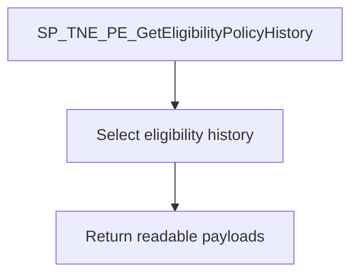

# SP_TNE_PE_GetEligibilityPolicyHistory

## What it does

Returns eligibility payload history for one policy, including raw payload JSON snapshots and readable JSON with type names for the history UI.

## Parameters

| Name | Direction | What it is for |
|---|---|---|
| `@PolicyId` | in | Policy whose eligibility payload history is returned |

## Call sequence

Calls no other procedures or functions.

## Callers

No other procedure or function calls this object. `PolicyEngineDAL.GetEligibilityPolicyHistory` and `GetCombinedPolicyHistory` execute it from the Policy Engine API.

## Nested

Calls no other procedures or functions.

## Steps

1. In `HRMS-DATABASE/HRMS_TRAVELNEXPENSE/STOREPROCEDURE/SP_TNE_PE_GetEligibilityPolicyHistory.sql`, select eligibility history rows for `@PolicyId`.
2. Project old and new payload JSON plus readable expansions that join `TNE_TypeRegistry` and related lookup names.

## Tables

| Table | Read or write |
|---|---|
| eligibility payload history table used by the SELECT | read |
| `TNE_TypeRegistry` | read |

## Flow

