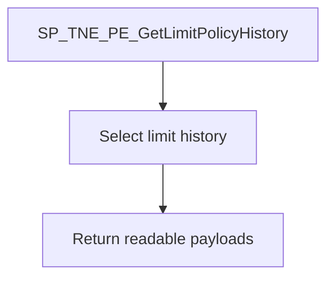

# SP_TNE_PE_GetLimitPolicyHistory

## What it does

Returns limit payload history for one policy, including raw payload JSON snapshots and readable JSON with type names. Combined history for limit policies loads this after core history.

## Parameters

| Name | Direction | What it is for |
|---|---|---|
| `@PolicyId` | in | Policy whose limit payload history is returned |

## Call sequence

Calls no other procedures or functions.

## Callers

No other procedure or function calls this object. `PolicyEngineDAL.GetLimitPolicyHistory` (via `GetCombinedPolicyHistory`) executes it from the Policy Engine API.

## Nested

Calls no other procedures or functions.

## Steps

1. In `HRMS-DATABASE/HRMS_TRAVELNEXPENSE/STOREPROCEDURE/SP_TNE_PE_GetLimitPolicyHistory.sql`, select limit history rows for `@PolicyId`.
2. Project old and new payload JSON plus readable expansions with type names.

## Tables

| Table | Read or write |
|---|---|
| limit payload history table used by the SELECT | read |
| `TNE_TypeRegistry` | read |

## Flow

