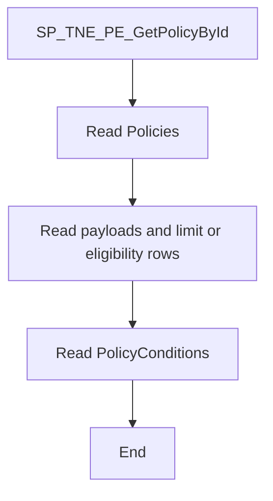

# SP_TNE_PE_GetPolicyById

## What it does

Returns three result sets for one non-deleted policy: the `Policies` header, active payloads joined to limit and eligibility payload tables and type registry names, and active conditions.

## Parameters

| Name | Direction | What it is for |
|---|---|---|
| `@PolicyId` | in | Policy to load |

## Call sequence

Calls no other procedures or functions.

## Callers

| Object | Kind | Page |
|---|---|---|
| `SP_TNE_PE_CreatePolicy` | procedure | [SP_TNE_PE_CreatePolicy](/docs/database/hrms-travelnexpense/SP_TNE_PE_CreatePolicy) |
| `SP_TNE_PE_UpdatePolicy` | procedure | [SP_TNE_PE_UpdatePolicy](/docs/database/hrms-travelnexpense/SP_TNE_PE_UpdatePolicy) |

`PolicyEngineDAL.GetPolicyById` also executes it from the Policy Engine API.

## Nested

Calls no other procedures or functions.

## Steps

1. In `HRMS-DATABASE/HRMS_TRAVELNEXPENSE/STOREPROCEDURE/SP_TNE_PE_GetPolicyById.sql`, select the policy header from `Policies` where `PolicyId` matches and `IsDeleted = 0`.
2. Select active `PolicyPayloads` for that policy, left-joining `TNE_PE_PolicyLimitPayload`, `TNE_PE_PolicyEligibilityPayload`, `TCountry`, and `TNE_TypeRegistry` for names and limit fields.
3. Select active `PolicyConditions` ordered by `ConditionKey`.

## Tables

| Table | Read or write |
|---|---|
| `Policies` | read |
| `PolicyPayloads` | read |
| `PolicyConditions` | read |
| `TNE_PE_PolicyLimitPayload` | read |
| `TNE_PE_PolicyEligibilityPayload` | read |
| `TNE_TypeRegistry` | read |
| `TCountry` | read |

## Flow

