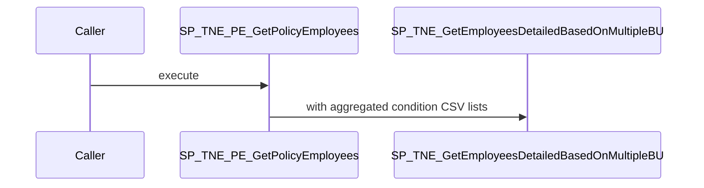
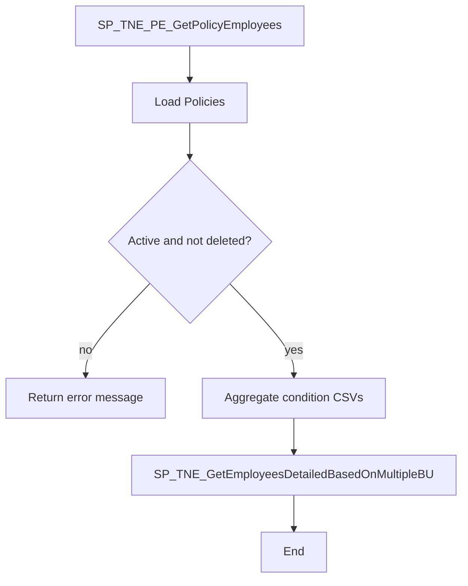

# SP_TNE_PE_GetPolicyEmployees

## What it does

Reads an active policy's conditions, aggregates ids per condition key, and returns matching employees by calling `SP_TNE_GetEmployeesDetailedBasedOnMultipleBU`.

## Parameters

| Name | Direction | What it is for |
|---|---|---|
| `@PolicyId` | in | Policy whose conditions define the employee set |

## Call sequence

## Callers

No other procedure or function calls this object. `PolicyEngineDAL.GetPolicyEmployees` executes it from the Policy Engine API.

## Nested

| Object | Kind | When | Page |
|---|---|---|---|
| `SP_TNE_GetEmployeesDetailedBasedOnMultipleBU` | procedure | after conditions are aggregated | [SP_TNE_GetEmployeesDetailedBasedOnMultipleBU](/docs/database/hrms-travelnexpense/SP_TNE_GetEmployeesDetailedBasedOnMultipleBU) |

## Steps

1. In `HRMS-DATABASE/HRMS_TRAVELNEXPENSE/STOREPROCEDURE/SP_TNE_PE_GetPolicyEmployees.sql`, load the policy and return an error result when missing, inactive, or deleted.
2. Aggregate active condition values for employee, business unit, designation, grade, location, work location, employment type, and role into CSV strings.
3. Execute `SP_TNE_GetEmployeesDetailedBasedOnMultipleBU` with the policy employer and those CSV filters.

## Tables

| Table | Read or write |
|---|---|
| `Policies` | read |
| `PolicyConditions` | read |

## Flow

