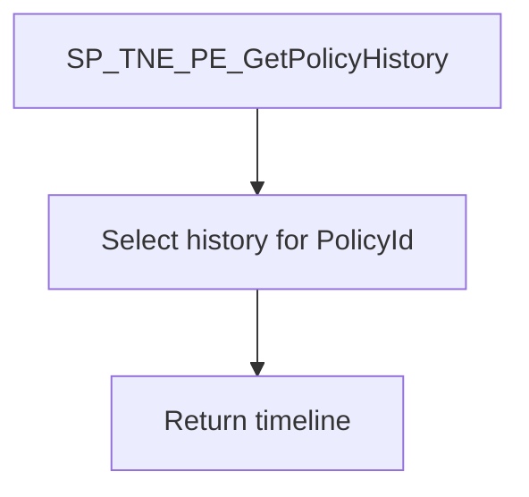

# SP_TNE_PE_GetPolicyHistory

## What it does

Returns the core policy change timeline for one policy id, including old and new name, dates, priority, active and strict flags, and readable condition JSON for the history UI.

## Parameters

| Name | Direction | What it is for |
|---|---|---|
| `@PolicyId` | in | Policy whose history is returned |

## Call sequence

Calls no other procedures or functions.

## Callers

No other procedure or function calls this object. `PolicyEngineDAL.GetPolicyHistory` and `GetCombinedPolicyHistory` execute it from the Policy Engine API.

## Nested

Calls no other procedures or functions.

## Steps

1. In `HRMS-DATABASE/HRMS_TRAVELNEXPENSE/STOREPROCEDURE/SP_TNE_PE_GetPolicyHistory.sql`, select history rows for `@PolicyId`.
2. Project action metadata and old/new core fields.
3. Build readable condition JSON by expanding stored condition snapshots against masters such as `TGrade` where needed.

## Tables

| Table | Read or write |
|---|---|
| policy history table used by the SELECT | read |
| `TGrade` | read |

## Flow

