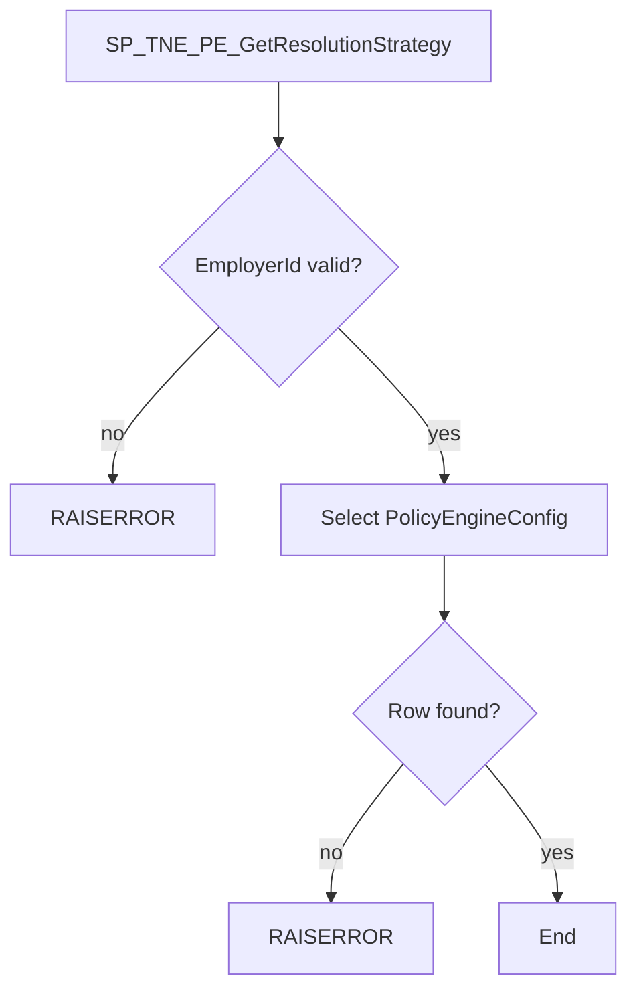

# SP_TNE_PE_GetResolutionStrategy

## What it does

Returns the active resolution strategy from `PolicyEngineConfig` for a module, policy type, and employer, falling back to `EmployerId = 0` when no employer-specific row exists.

## Parameters

| Name | Direction | What it is for |
|---|---|---|
| `@ModuleKey` | in | Module |
| `@EmployerId` | in | Employer; must be positive |
| `@PolicyTypeKey` | in | Policy type |

## Call sequence

Calls no other procedures or functions.

## Callers

No other procedure or function calls this object. `PolicyEngineDAL.GetResolutionStrategyAsync` executes it from Engine Settings.

## Nested

Calls no other procedures or functions.

## Steps

1. In `HRMS-DATABASE/HRMS_TRAVELNEXPENSE/STOREPROCEDURE/SP_TNE_PE_GetResolutionStrategy.sql`, reject a non-positive `@EmployerId`.
2. Select top 1 `ResolutionStrategy` from active `PolicyEngineConfig` rows for the module and type where `EmployerId` is the requested employer or `0`, preferring the employer-specific row.
3. Raise an error when no row is found.

## Tables

| Table | Read or write |
|---|---|
| `PolicyEngineConfig` | read |

## Flow

