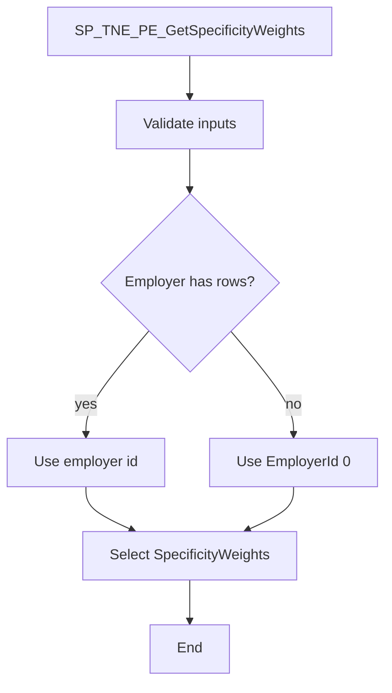

# SP_TNE_PE_GetSpecificityWeights

## What it does

Returns active specificity weights for a module. When the employer has no rows, it falls back to the template rows with `EmployerId = 0`.

## Parameters

| Name | Direction | What it is for |
|---|---|---|
| `@ModuleKey` | in | Module |
| `@EmployerId` | in | Employer; must be positive |

## Call sequence

Calls no other procedures or functions.

## Callers

| Object | Kind | Page |
|---|---|---|
| `SP_TNE_PE_UpdateSpecificityWeights` | procedure | [SP_TNE_PE_UpdateSpecificityWeights](/docs/database/hrms-travelnexpense/SP_TNE_PE_UpdateSpecificityWeights) |

`PolicyEngineDAL.GetSpecificityWeights` also executes it from Engine Settings.

## Nested

Calls no other procedures or functions.

## Steps

1. In `HRMS-DATABASE/HRMS_TRAVELNEXPENSE/STOREPROCEDURE/SP_TNE_PE_GetSpecificityWeights.sql`, validate module and employer.
2. Choose `@UseEmployerId` as the requested employer when active rows exist, otherwise `0`.
3. Return active `SpecificityWeights` for that employer and module, ordered by `ConditionKey`.

## Tables

| Table | Read or write |
|---|---|
| `SpecificityWeights` | read |

## Flow

