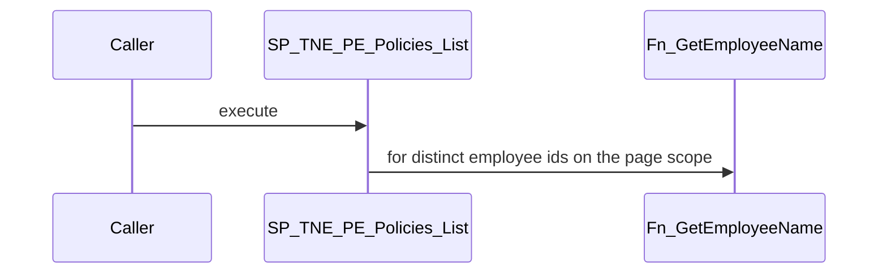
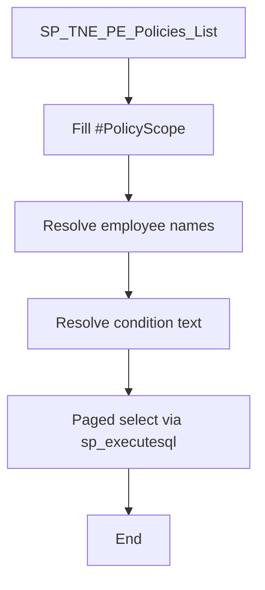

# SP_TNE_PE_Policies_List

## What it does

Returns a paged list of active, non-deleted policies for a module and policy type, with human-readable condition text and creator or modifier names. A second result set is the total count.

## Parameters

| Name | Direction | What it is for |
|---|---|---|
| `@ModuleKey` | in | Module filter |
| `@PolicyTypeKey` | in | Policy type filter |
| `@EmployerId` | in | Optional employer filter |
| `@Search` | in | Optional name search |
| `@PageNumber` | in | Page index, default 1 |
| `@PageSize` | in | Page size, default 50 |
| `@SortBy` | in | Sort column name, default `ModifiedDate` |
| `@SortDir` | in | `ASC` or `DESC`, default `DESC` |

## Call sequence

## Callers

No other procedure or function calls this object. `PolicyEngineDAL.ListPolicies` executes it from Policy Setup list APIs.

## Nested

| Object | Kind | When | Page |
|---|---|---|---|
| `Fn_GetEmployeeName` | function | when resolving created-by, modified-by, and employeeId condition labels | [Fn_GetEmployeeName](/docs/database/hrms/Fn_GetEmployeeName) |

## Steps

1. In `HRMS-DATABASE/HRMS_TRAVELNEXPENSE/STOREPROCEDURE/SP_TNE_PE_Policies_List.sql`, load matching `Policies` into `#PolicyScope`.
2. Resolve distinct employee ids into `#EmployeeNames` via `dbo.Fn_GetEmployeeName`.
3. Build `#ResolvedConditions` by expanding condition keys against roles, org units, titles, grades, locations, employment types, and employee names.
4. Assemble the paged result with dynamic `ORDER BY` and return the page plus total count.

## Tables

| Table | Read or write |
|---|---|
| `Policies` | read |
| `PolicyConditions` | read |
| `PolicyPayloads` | read |
| `SpecificityWeights` | read |
| `TRoles` | read |
| `TOrgHierarchyDetails` | read |
| `TTitle` | read |
| `TGrade` | read |
| `TLocation` | read |
| `TMEmploymentTypes` | read |

## Unresolved calls

Dynamic `sp_executesql` builds the final sorted page query from `@SortBy` and `@SortDir`.

## Flow

