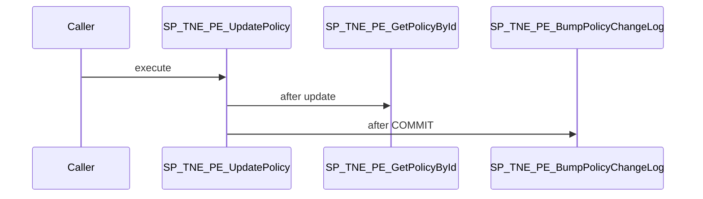
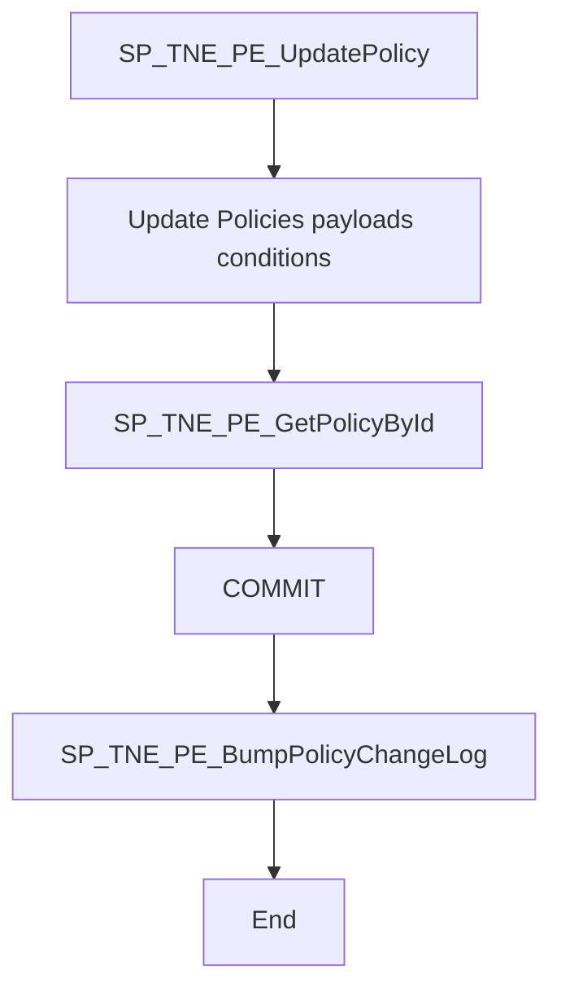

# SP_TNE_PE_UpdatePolicy

## What it does

Updates an existing policy header and replaces or refreshes payloads and conditions from the posted JSON. Writes history, returns the policy through `SP_TNE_PE_GetPolicyById`, and bumps `TNE_PE_PolicyChangeLog` after commit.

## Parameters

Principal inputs (see the SQL file for the full list):

| Name | Direction | What it is for |
|---|---|---|
| `@PolicyId` | in | Policy to update |
| `@PolicyName` | in | New name |
| `@PolicyDescription` | in | New description |
| `@Priority` | in | Priority |
| `@EffectiveFrom` | in | Start date |
| `@EffectiveTo` | in | End date |
| `@IsActive` | in | Active flag |
| `@PayloadsJson` | in | Optional replacement payloads |
| `@ConditionsJson` | in | Optional replacement conditions |
| `@UpdatedBy` | in | Actor employee id |
| `@Strict` | in | Strict flag |
| `@SubmissionRule` | in | Optional submission rule |
| `@SubmissionRuleEnable` | in | Submission-rule flag |
| `@UpdateModifiedDate` | in | Whether to refresh modified date |

## Call sequence

## Callers

No other procedure or function calls this object. `PolicyEngineDAL.UpdatePolicy` executes it from the Policy Engine API.

## Nested

| Object | Kind | When | Page |
|---|---|---|---|
| `SP_TNE_PE_GetPolicyById` | procedure | after the update succeeds | [SP_TNE_PE_GetPolicyById](/docs/database/hrms-travelnexpense/SP_TNE_PE_GetPolicyById) |
| `SP_TNE_PE_BumpPolicyChangeLog` | procedure | after COMMIT | [SP_TNE_PE_BumpPolicyChangeLog](/docs/database/hrms-travelnexpense/SP_TNE_PE_BumpPolicyChangeLog) |

## Steps

1. In `HRMS-DATABASE/HRMS_TRAVELNEXPENSE/STOREPROCEDURE/SP_TNE_PE_UpdatePolicy.sql`, load the existing policy and validate dates.
2. Update `Policies` and rewrite payload and condition rows according to the posted JSON.
3. Insert history, execute `SP_TNE_PE_GetPolicyById`, commit, then bump the change log.

## Tables

| Table | Read or write |
|---|---|
| `Policies` | read then write |
| `PolicyPayloads` | read then write |
| `PolicyConditions` | read then write |
| `TNE_PE_PolicyLimitPayload` | write |
| `TNE_PE_PolicyEligibilityPayload` | write |
| policy history tables | write |

## Flow

