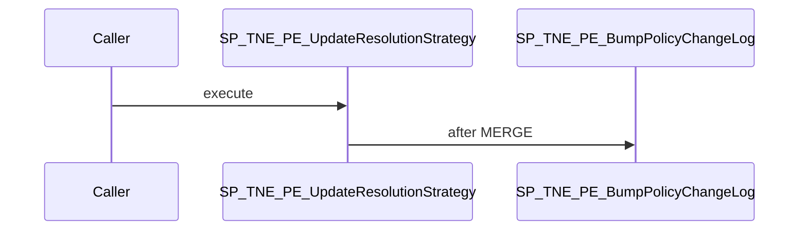
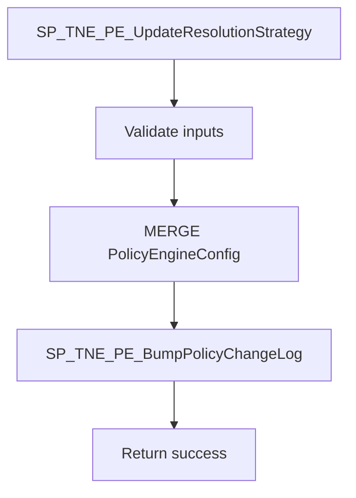

# SP_TNE_PE_UpdateResolutionStrategy

## What it does

Upserts the resolution strategy on `PolicyEngineConfig` for a module, employer, and policy type, then bumps the policy change log for that scope.

## Parameters

| Name | Direction | What it is for |
|---|---|---|
| `@ModuleKey` | in | Module |
| `@EmployerId` | in | Employer |
| `@PolicyTypeKey` | in | `eligibility`, `limit`, or `accrual` |
| `@ResolutionStrategy` | in | `UNION`, `DENY_OVERRIDES`, `LATEST_WINS`, or `MOST_SPECIFIC` |
| `@UpdatedBy` | in | Actor id string |

## Call sequence

## Callers

No other procedure or function calls this object. `PolicyEngineDAL.UpdateResolutionStrategyAsync` executes it from Engine Settings.

## Nested

| Object | Kind | When | Page |
|---|---|---|---|
| `SP_TNE_PE_BumpPolicyChangeLog` | procedure | after the MERGE | [SP_TNE_PE_BumpPolicyChangeLog](/docs/database/hrms-travelnexpense/SP_TNE_PE_BumpPolicyChangeLog) |

## Steps

1. In `HRMS-DATABASE/HRMS_TRAVELNEXPENSE/STOREPROCEDURE/SP_TNE_PE_UpdateResolutionStrategy.sql`, validate module, employer, policy type, and strategy values.
2. MERGE `PolicyEngineConfig` to update or insert the strategy.
3. Execute `SP_TNE_PE_BumpPolicyChangeLog`.
4. Return a success result set with the posted keys and strategy.

## Tables

| Table | Read or write |
|---|---|
| `PolicyEngineConfig` | write |

## Flow

