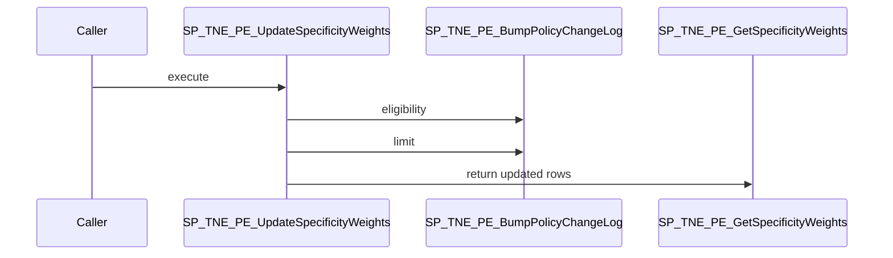
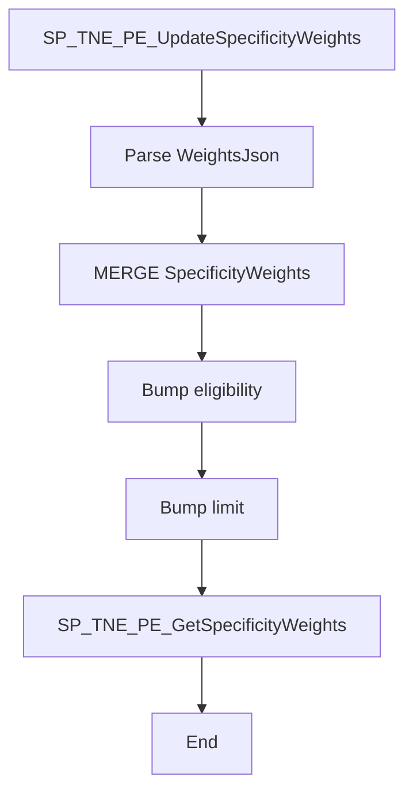

# SP_TNE_PE_UpdateSpecificityWeights

## What it does

Merges employer-specific specificity weights from JSON, copies titles from the `EmployerId = 0` template, bumps the change log for both `eligibility` and `limit`, then returns the updated weights via `SP_TNE_PE_GetSpecificityWeights`.

## Parameters

| Name | Direction | What it is for |
|---|---|---|
| `@ModuleKey` | in | Module |
| `@EmployerId` | in | Employer |
| `@WeightsJson` | in | JSON array of condition keys, weight values, and active flags |
| `@UpdatedBy` | in | Actor id string |

## Call sequence

## Callers

No other procedure or function calls this object. `PolicyEngineDAL.UpdateSpecificityWeights` executes it from Engine Settings.

## Nested

| Object | Kind | When | Page |
|---|---|---|---|
| `SP_TNE_PE_BumpPolicyChangeLog` | procedure | twice, for eligibility and limit | [SP_TNE_PE_BumpPolicyChangeLog](/docs/database/hrms-travelnexpense/SP_TNE_PE_BumpPolicyChangeLog) |
| `SP_TNE_PE_GetSpecificityWeights` | procedure | after the MERGE | [SP_TNE_PE_GetSpecificityWeights](/docs/database/hrms-travelnexpense/SP_TNE_PE_GetSpecificityWeights) |

## Steps

1. In `HRMS-DATABASE/HRMS_TRAVELNEXPENSE/STOREPROCEDURE/SP_TNE_PE_UpdateSpecificityWeights.sql`, validate module, employer, and JSON.
2. Parse `@WeightsJson` and join default template titles from `SpecificityWeights` where `EmployerId = 0`.
3. Reject weights outside 0–1000.
4. MERGE into `SpecificityWeights` for the employer.
5. Bump change log for eligibility and limit, then execute `SP_TNE_PE_GetSpecificityWeights`.

## Tables

| Table | Read or write |
|---|---|
| `SpecificityWeights` | read then write |

## Flow

