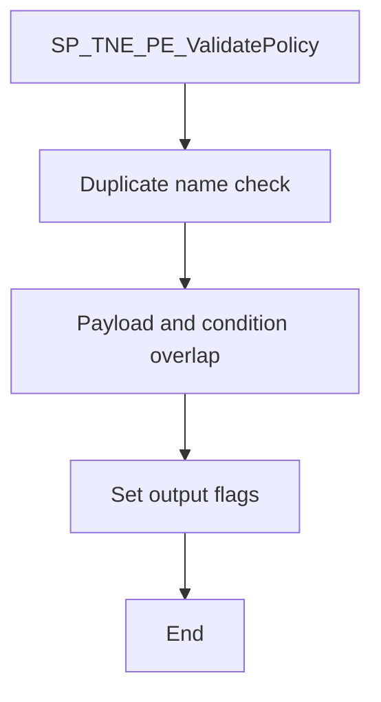

# SP_TNE_PE_ValidatePolicy

## What it does

Checks a proposed create or update for duplicate policy names and overlapping payload or condition conflicts. Sets output flags and a JSON list of conflicting policies.

## Parameters

| Name | Direction | What it is for |
|---|---|---|
| `@PolicyId` | in | Null for create; existing id for update |
| `@ModuleKey` | in | Module |
| `@PolicyTypeKey` | in | Policy type |
| `@PolicyName` | in | Name to validate |
| `@EffectiveFrom` | in | Effective start |
| `@EffectiveTo` | in | Effective end |
| `@PayloadsJson` | in | Optional payload JSON |
| `@ConditionsJson` | in | Optional conditions JSON |
| `@EmployerId` | in | Optional employer scope |
| `@EmployeeId` | in | Optional employee context |
| `@IsValid` | out | 1 when valid |
| `@ValidationMessage` | out | Human message |
| `@ConflictingPolicies` | out | JSON conflict array |

## Call sequence

Calls no other procedures or functions.

## Callers

No other procedure or function calls this object. `PolicyEngineDAL.ValidatePolicy` executes it from the Policy Engine API.

## Nested

Calls no other procedures or functions.

## Steps

1. In `HRMS-DATABASE/HRMS_TRAVELNEXPENSE/STOREPROCEDURE/SP_TNE_PE_ValidatePolicy.sql`, initialize `@IsValid = 1` and empty conflict outputs.
2. Detect duplicate active policy names for the same module, type, and employer, excluding `@PolicyId` on update.
3. Compare proposed payloads and conditions to existing active policies and collect conflict rows.
4. Set `@IsValid`, `@ValidationMessage`, and `@ConflictingPolicies` from the conflict table.

## Tables

| Table | Read or write |
|---|---|
| `Policies` | read |
| `PolicyPayloads` | read |
| `PolicyConditions` | read |
| `TNE_TypeRegistry` | read |

## Flow

