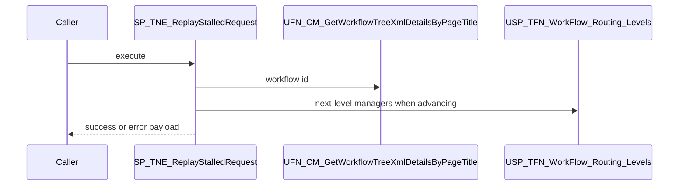
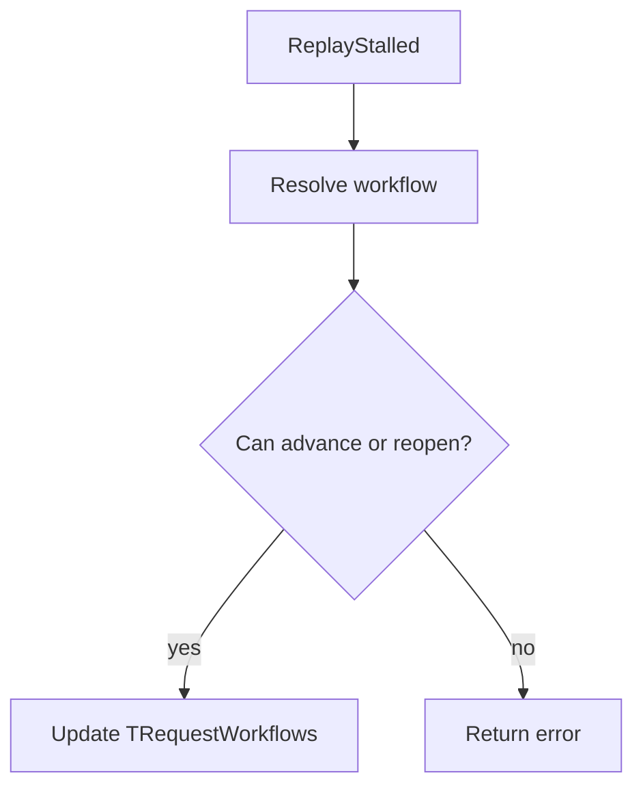

# SP_TNE_ReplayStalledRequest

## What it does

Attempts to unstall an expense approval by resolving the workflow id from the email notification module page name, then either advancing `TRequestWorkflows` to the next routing level via `USP_TFN_WorkFlow_Routing_Levels` or reopening a completed level to pending. Returns `IsSuccess` / `ErrorMessage` / `ErrorCode` style result.

## Parameters

| Name | Direction | What it is for |
|---|---|---|
| `@employerId` | in | Employer |
| `@expenseId` | in | Expense id |

## Call sequence

## Callers

App: `ExpenseDAL.StalledRequestResponse` → `ExpenseController.ReplayStalledRequest` from [Expense Requests](/docs/guides/expense-and-reimbursement/expense-requests).

## Nested

| Object | Kind | When | Page |
|---|---|---|---|
| `UFN_CM_GetWorkflowTreeXmlDetailsByPageTitle` | function | resolve workflow | [UFN_CM_GetWorkflowTreeXmlDetailsByPageTitle](/docs/database/hrms/UFN_CM_GetWorkflowTreeXmlDetailsByPageTitle) |
| `USP_TFN_WorkFlow_Routing_Levels` | function | next managers when advancing | [USP_TFN_WorkFlow_Routing_Levels](/docs/database/hrms/USP_TFN_WorkFlow_Routing_Levels) |

## Steps

1. Script is `SP_TNE_ReplayStalledRequest.sql`.
2. Read module page name from `TEMAIL_NOTIFICATION` and subject from `TEXPENSE`.
3. Resolve `@WorkflowId` via UFN; inspect existing `TRequestWorkflows`.
4. If next-level managers exist and current level is complete, insert/update routing; else reopen pending or return an error message.

## Tables

| Table | Read or write |
|---|---|
| `TEMAIL_NOTIFICATION` | read |
| `TEXPENSE` | read |
| `TRequestWorkflows` | read/write |
| `TWorkflowManagement` | read |

## Unresolved calls

None at one nested level.

## Flow

