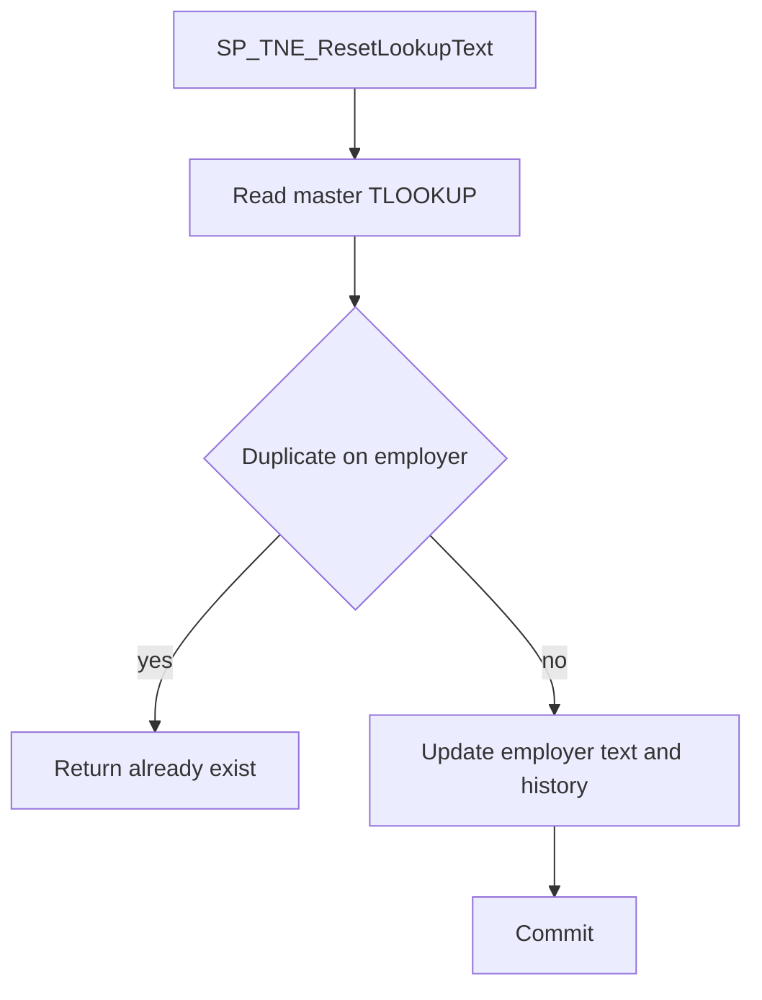

# SP_TNE_ResetLookupText

## What it does

Stored procedure `SP_TNE_ResetLookupText`. Reads the master (`EmployerId = 0`) lookup text for `@LookupId` and writes that text onto the employer row when no conflicting active duplicate exists. Writes `TLOOKUP_HISTORY`. Calls no nested procedure.

## Parameters

| Name | Direction | What it is for |
|---|---|---|
| `@Employerid` | in | INT |
| `@LookupId` | in | INT |
| `@LookupText` | in | NVARCHAR(100) — supplied by the API; master text is what is applied |
| `@UpdatedBy` | in | INT |
| `@UpdatedOn` | in | DATETIME |

## Call sequence

Calls no other procedures or functions.

## Callers

No other procedure or function in this database calls this object. Application caller: Travel WebAPI `ResetLookupText` via `TravelDAL.ResetLookupText`.

| Caller | Page |
|---|---|
| (application only) | No page yet |

## Nested

Calls no other procedures or functions.

## Steps

1. Script is `HRMS-DATABASE/HRMS_TRAVELNEXPENSE/STOREPROCEDURE/SP_TNE_ResetLookupText.sql`.
2. Begin transaction.
3. Load master lookup text/parent/sub-parent/`isDeleted` for `@LookupId` where `EmployerId = 0`.
4. If employer already has an active row with that master text under the same parent/sub-parent, return already-exist failure.
5. Otherwise update employer `Lookup_Text`, insert history, return success.
6. On error, roll back and return failure; otherwise commit.

## Tables

| Table | Read or write |
|---|---|
| `TLOOKUP` | read and write |
| `TLOOKUP_HISTORY` | write |

## Flow

