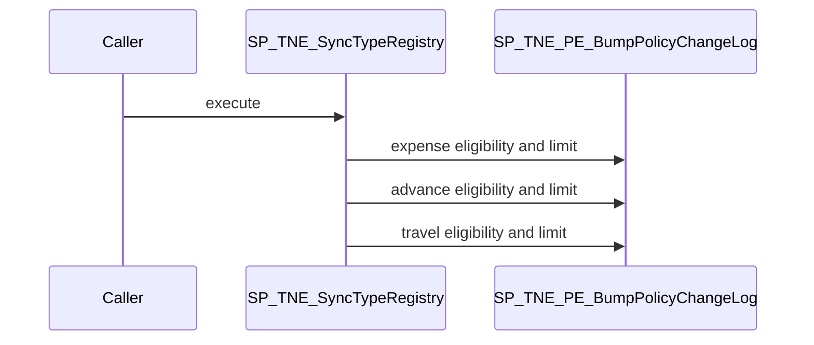
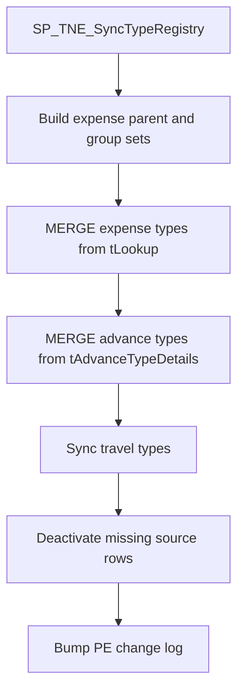

# SP_TNE_SyncTypeRegistry

## What it does

Manual sync of `TNE_TypeRegistry` from source masters: expense types in `tLookup` (legacy parents and grouped expense types), advance types in `tAdvanceTypeDetails`, and travel types. Deactivates registry rows whose source rows are gone. Optionally filters to one employer. At the end it bumps Policy Engine change-log entries so caches refresh.

Advance Setup reaches this procedure only as a nested call from `SP_Advances_InsUpdAdvanceTypeDetails` after an advance type insert or update.

## Parameters

| Name | Direction | What it is for |
|---|---|---|
| `@EmployerId` | in | Null syncs all employers; set syncs one employer |

## Call sequence

## Callers

| Object | Kind | Page |
|---|---|---|
| `SP_Advances_InsUpdAdvanceTypeDetails` | procedure | [SP_Advances_InsUpdAdvanceTypeDetails](/docs/database/hrms-travelnexpense/SP_Advances_InsUpdAdvanceTypeDetails) |
| `Sp_TnE_TLOOKUP_INS_UPD` | procedure | No page yet |
| `Sp_TnE_TLOOKUP_DEL` | procedure | No page yet |
| `Sp_TnE_RestoreLookupItemByLookupId` | procedure | No page yet |
| `SP_TNE_AddingNewEmployerInTLookup` | procedure | No page yet |

`SP_TNE_CreateDefaultTravelEligibilityPolicies` mentions this procedure in print guidance; it is not an `EXEC` caller in that script body.

## Nested

| Object | Kind | When | Page |
|---|---|---|---|
| `SP_TNE_PE_BumpPolicyChangeLog` | procedure | after sync, once per employer/module/policy-type combination | [SP_TNE_PE_BumpPolicyChangeLog](/docs/database/hrms-travelnexpense/SP_TNE_PE_BumpPolicyChangeLog) |

## Steps

1. Build helper sets for legacy expense parents and new expense groups / types under lookup parent `2700`.
2. MERGE expense parent and grouped expense types from `tLookup` into `TNE_TypeRegistry` (`ModuleKey = 'expense'`).
3. MERGE advance types from `tAdvanceTypeDetails` into `TNE_TypeRegistry` (`ModuleKey = 'advance'`).
4. Sync travel types from their lookup sources (later steps in the same script).
5. Deactivate registry rows whose source advance/expense/travel rows no longer exist.
6. For each affected employer, execute `SP_TNE_PE_BumpPolicyChangeLog` for expense, advance, and travel eligibility and limit policy types.

## Tables

| Table | Read or write |
|---|---|
| `dbo.tLookup` | read |
| `dbo.tAdvanceTypeDetails` | read |
| `dbo.TNE_TypeRegistry` | read/write |

## Flow

