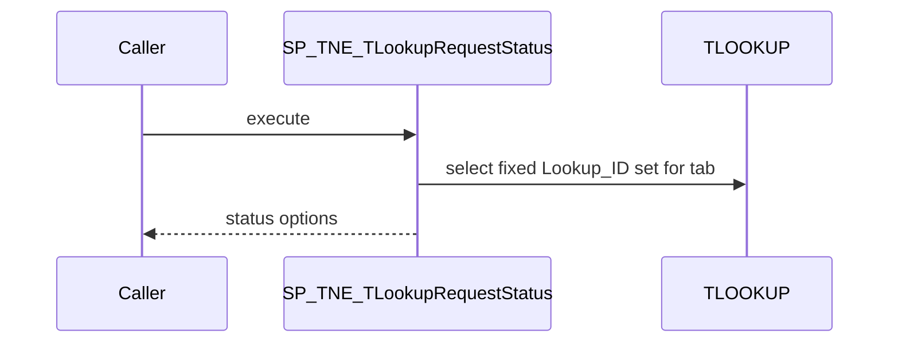
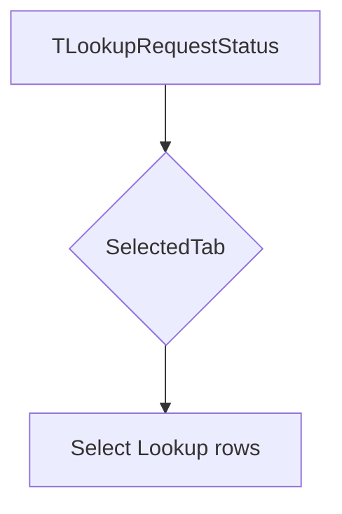

# SP_TNE_TLookupRequestStatus

## What it does

Returns `Lookup_ID` / `Lookup_Text` pairs from `TLOOKUP` for the expense request status filter, with a fixed id set that depends on `@SelectedTab` (My / Team / All / other).

## Parameters

| Name | Direction | What it is for |
|---|---|---|
| `@EmployerId` | in | Employer for lookup rows |
| `@SelectedTab` | in | Tab number (1 My, 2 Team, 3 All, else reimbursement-style set) |

## Call sequence

## Callers

App: `ExpenseDAL.GetAllLookupRequestStatus` → `ExpenseController.GetAllLookupRequestStatus` from status filter on [Expense Requests](/docs/guides/expense-and-reimbursement/expense-requests).

## Nested

None.

## Steps

1. Script is `SP_TNE_TLookupRequestStatus.sql`.
2. Branch on `@SelectedTab` and select a hard-coded list of lookup ids for that employer.

## Tables

| Table | Read or write |
|---|---|
| `TLOOKUP` | read |

## Unresolved calls

None.

## Flow

