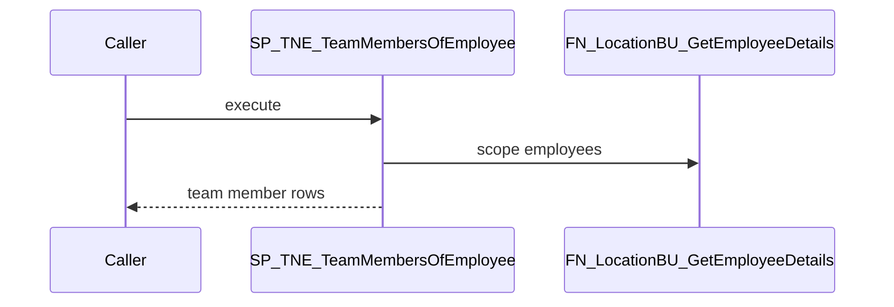
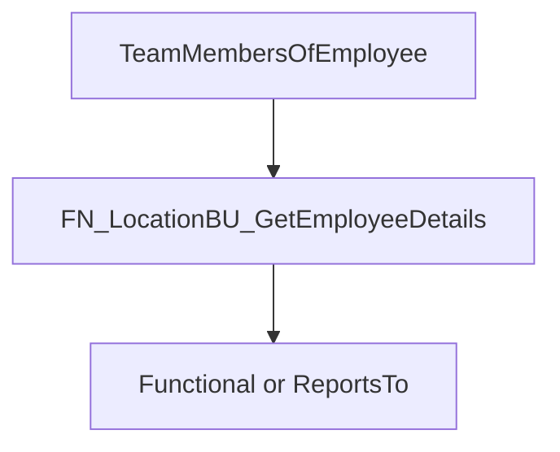

# SP_TNE_TeamMembersOfEmployee

## What it does

Returns active employees under the given manager via functional manager or org-chart reports-to, intersected with `FN_LocationBU_GetEmployeeDetails` scope for that manager.

## Parameters

| Name | Direction | What it is for |
|---|---|---|
| `@pEmployeeId` | in | Manager employee id |
| `@EmployerId` | in | Employer |

## Call sequence

## Callers

App: `ExpenseDAL.GetTeamMembersOfEmployee` → `ExpenseController.GetTeamMembersOfEmployee` from [Expense Requests](/docs/guides/expense-and-reimbursement/expense-requests) filters.

## Nested

| Object | Kind | When | Page |
|---|---|---|---|
| `FN_LocationBU_GetEmployeeDetails` | function | always | [FN_LocationBU_GetEmployeeDetails](/docs/database/hrms-travelnexpense/FN_LocationBU_GetEmployeeDetails) |

## Steps

1. Script is `SP_TNE_TeamMembersOfEmployee.sql`.
2. Join employee/info/BU to scope function results.
3. Keep rows where functional manager or `TORGChart.ReportsTo` is `@pEmployeeId` and employee is active for employer.

## Tables

| Table | Read or write |
|---|---|
| `TEmployee` | read |
| `TEmployeeInfo` | read |
| `TOrgHierarchyDetails` | read |
| `TORGChart` | read |

## Unresolved calls

None.

## Flow

