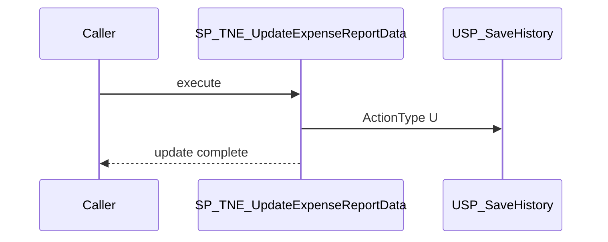
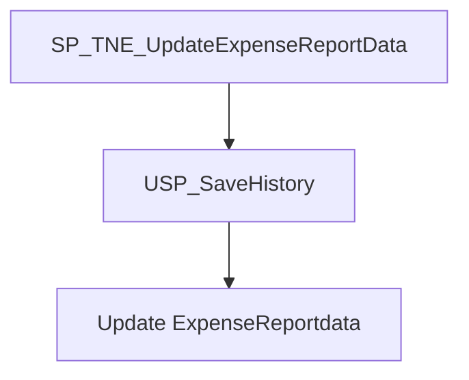

# SP_TNE_UpdateExpenseReportData

## What it does

Updates an existing `ExpenseReportdata` row after writing a history snapshot via `USP_SaveHistory`.

## Parameters

| Name | Direction | What it is for |
|---|---|---|
| `@ReportID` | in | Primary key |
| `@EmployeeID` | in | Owner employee |
| `@ReportName` | in | Title |
| `@EmployerID` | in | Employer |
| `@Sharedwith` | in | Share list |
| `@Fields` | in | Column list |
| `@Filter_Json` | in | Filters JSON |
| `@Updatedby` | in | Updating employee |
| `@Description` | in | Description |

## Call sequence

## Callers

| Caller | Page |
|---|---|
| `ReportsDAL.EditExpenseSavedReportData` | [Report](/docs/guides/expense-and-reimbursement/report) |

## Nested

| Object | Kind | When | Page |
|---|---|---|---|
| `USP_SaveHistory` | procedure (T&E synonym to HRMS) | before UPDATE | unresolved — no CREATE script in HRMS Liquibase inventory |

## Steps

1. `EXEC USP_SaveHistory` for `ExpenseReportdata` → `ExpenseReportdata_History`, action `U`.
2. Update name, share, fields, filter JSON, description, `Updatedby`/`UpdatedDate`.

## Tables

| Table | Read or write |
|---|---|
| `ExpenseReportdata` | write |
| `ExpenseReportdata_History` | write via history helper |

## Unresolved calls

`USP_SaveHistory` body is not in `HRMS-DATABASE/HRMS` as a standalone script (synonym only on T&E).

## Flow

