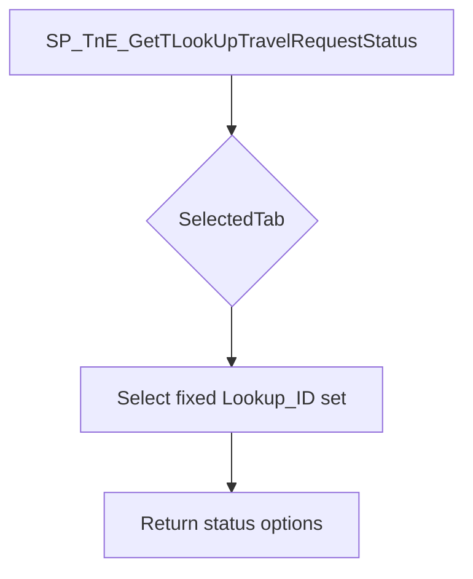

# SP_TnE_GetTLookUpTravelRequestStatus

## What it does

Returns the status filter dropdown options for Travel Requests tabs from `TLOOKUP`. The allowed `Lookup_ID` set depends on `@SelectedTab` (My / Notifications / Team / All).

## Parameters

| Name | Direction | What it is for |
|---|---|---|
| `@EmployerId` | in | Employer whose lookups are read |
| `@SelectedTab` | in | Tab code (1 My, 2 Notifications, 5 Team, 3 All) |

## Call sequence

Calls no other procedures or functions.

## Callers

| Caller | Page |
|---|---|
| `TravelDAL.GetAllTravelLookupRequestStatus` | Travel Requests guide |

## Nested

Calls no other procedures or functions.

## Steps

1. Branch on `@SelectedTab`.
2. Select `Lookup_ID` / `Lookup_Text` from `TLOOKUP` for the fixed id list for that tab and employer.

## Tables

| Table | Read or write |
|---|---|
| `TLOOKUP` | read |

## Unresolved calls

None.

## Flow

