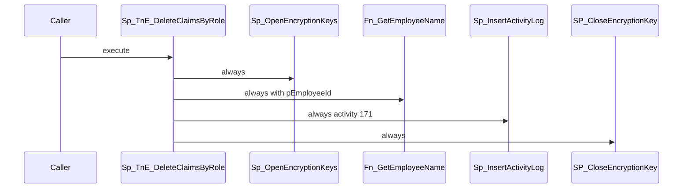
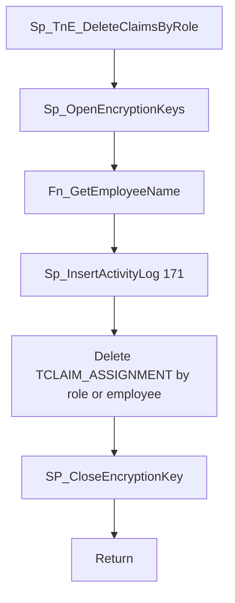

# Sp_TnE_DeleteClaimsByRole

## What it does

Deletes `TCLAIM_ASSIGNMENT` rows for one employer, either all rows for a role (`@pSearchType = 'R'`) or all rows for an employee (`@pSearchType = 'E'`). Permission Setup runs it before re-inserting checked claims, and alone when resetting an employee to role-based permissions.

## Parameters

| Name | Direction | What it is for |
|---|---|---|
| `@pRoleID` | in | Role id when `@pSearchType` is `R`. Default null |
| `@pEmployerId` | in | Employer filter on `TCLAIM_ASSIGNMENT.Employerid` |
| `@pSearchType` | in | `R` deletes by `RoleId`; `E` deletes by `EmployeeId` |
| `@pEmployeeId` | in | Employee id when `@pSearchType` is `E`. Default null |

## Call sequence

## Callers

No other procedure or function calls this object. App callers: `EmployeeDAL.DeleteClaimsBySearchType` from [Permission Setup](/docs/guides/admin-configuration/permission-setup) save and reset.

## Nested

| Object | Kind | When | Page |
|---|---|---|---|
| `Sp_OpenEncryptionKeys` | procedure | always | [Sp_OpenEncryptionKeys](/docs/database/hrms/Sp_OpenEncryptionKeys) |
| `Fn_GetEmployeeName` | function | always | [Fn_GetEmployeeName](/docs/database/hrms/Fn_GetEmployeeName) |
| `Sp_InsertActivityLog` | procedure | always, activity type 171 | [Sp_InsertActivityLog](/docs/database/hrms/Sp_InsertActivityLog) |
| `SP_CloseEncryptionKey` | procedure | always | [SP_CloseEncryptionKey](/docs/database/hrms/SP_CloseEncryptionKey) |

## Steps

1. Script is `HRMS-DATABASE/HRMS_TRAVELNEXPENSE/STOREPROCEDURE/Sp_TnE_DeleteClaimsByRole.sql`.
2. Execute `Sp_OpenEncryptionKeys`.
3. Resolve `@empname` with `Fn_GetEmployeeName(@pEmployeeId)` and build a comments string that includes the role id.
4. Execute `Sp_InsertActivityLog` with activity type `171`.
5. Delete from `TCLAIM_ASSIGNMENT` where employer matches and either `RoleId = @pRoleId` or `EmployeeId = @pEmployeeId` according to `@pSearchType`.
6. Execute `SP_CloseEncryptionKey`.

## Tables

| Table | Read or write |
|---|---|
| `TCLAIM_ASSIGNMENT` | write |

## Unresolved calls

None.

## Flow

