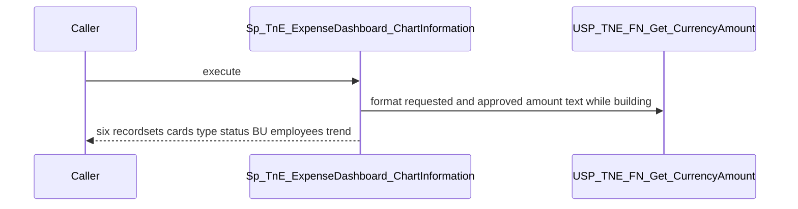
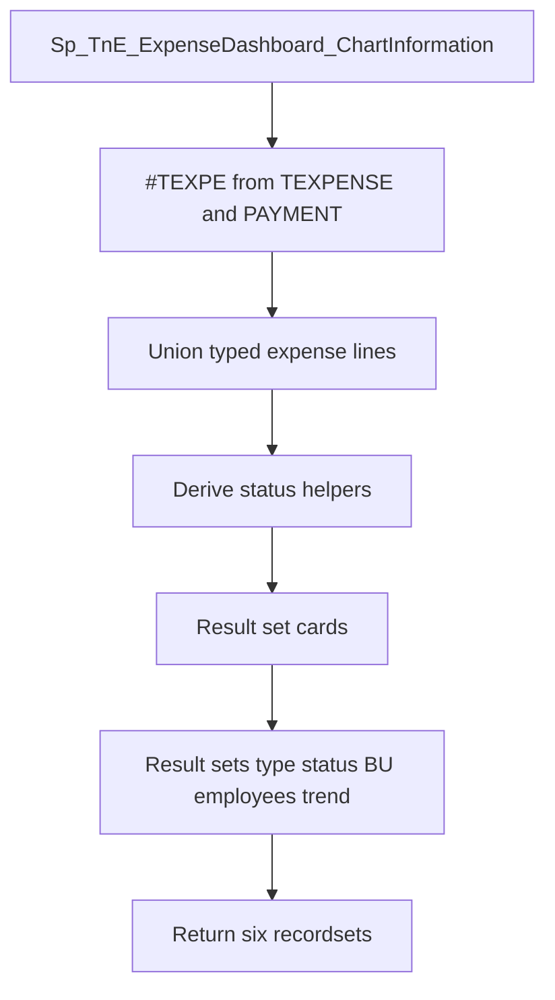

# Sp_TnE_ExpenseDashboard_ChartInformation

## What it does

Builds the Expense Dashboard chart payload for one employer, date window, report-date basis (`Created Date` vs `Amount Spent On`), and request currency. Filters submitted `TEXPENSE` + `TEXPENSE_PAYMENT` first, unions typed expense lines (travel, stay, conveyance, food, medical, other, project, telephone, DIM allowance, supplies, auto, parts/sales, custom `TEXPENSE_LINE_ITEMS`), then returns six result sets: summary cards, expense-by-type, expense-by-status, expenses-by-business-unit, expense-by-employees (period grain by range length), and compare-types trend. Uses `READ UNCOMMITTED` / `NOLOCK` on type-table reads.

## Parameters

| Name | Direction | What it is for |
|---|---|---|
| `@EmployerID` | in | Employer whose submitted expenses are aggregated |
| `@LoginEmployeeId` | in | Passed by API; not referenced in the procedure body |
| `@Fromdate` | in | Start of CreatedOn window (nulled when basis is Amount Spent On) |
| `@Todate` | in | End of CreatedOn window (exclusive day add in filter) |
| `@ReportDataBasedOn` | in | `Amount Spent On` switches filter to BillDate; otherwise CreatedOn |
| `@Currency` | in | `TCountry.CURRENCYCODE` used to resolve `@currencyid` for ReqCurrencyCodeId |

## Call sequence

## Callers

No other procedure or function calls this object. App callers: `travelNExpenseDAL.GetExpenseDashboardReports` → `travelNExpenseController.GetExpenseDashboardReports` from [Expense Dashboard](/docs/guides/expense-and-reimbursement/expense-dashboard).

## Nested

| Object | Kind | When | Page |
|---|---|---|---|
| `USP_TNE_FN_Get_CurrencyAmount` | function | while building `#TEXPE` amount display columns | [USP_TNE_FN_Get_CurrencyAmount](/docs/database/hrms-travelnexpense/USP_TNE_FN_Get_CurrencyAmount) |

## Steps

1. Script is `HRMS-DATABASE/HRMS_TRAVELNEXPENSE/STOREPROCEDURE/Sp_TnE_ExpenseDashboard_ChartInformation.sql`.
2. Resolve `@currencyid` from `TCountry` where `CURRENCYCODE = @Currency`. If basis is Amount Spent On, move dates to BillDate window variables and null CreatedOn dates.
3. Load `#TEXPE` from submitted `TEXPENSE` joined to `TEXPENSE_PAYMENT` for the employer, currency, and date window; format amounts via `USP_TNE_FN_Get_CurrencyAmount`.
4. Cache employer `TLOOKUP` into `#TLOOK`. Union typed expense tables into `#VE_TNE_ExpenseDetails` with status and type labels.
5. Derive cancel / completed / latest status helpers from `TEXPENSE_STATUS`.
6. Emit cards (Total Requested Amount, Total Approved Amount, Payments Pending, Payments Processed), then type pie, status pie, BU paid amounts, employees series, and type trend series (year / month / week / day grain from date span).

## Tables

| Table | Read or write |
|---|---|
| `TEXPENSE` | read |
| `TEXPENSE_PAYMENT` | read |
| `TEXPENSE_STATUS` | read |
| `TEXPENSE_TRAVEL`, `TEXPENSE_STAY`, `TEXPENSE_CONVEYANCE`, `TEXPENSE_FOODNBEV`, `TEXPENSE_MEDICAL`, `TEXPENSE_OTHER`, `TEXPENSE_PROJECT`, `TEXPENSE_TELEPHONE`, `TEXPENSE_DIMALLOWANCE`, `TEXPENSE_SUPPLIESOFFICE`, `TEXPENSE_AUTO`, `TEXPENSE_PARTSSALES`, `TEXPENSE_LINE_ITEMS` | read |
| `TLOOKUP` / `TLookup` | read |
| `TCountry` | read |
| `TEmployeeInfo` | read (synonym) |
| `TOrgHierarchyDetails` | read (synonym) |

## Unresolved calls

None.

## Flow

