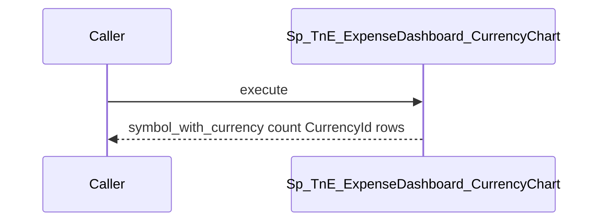
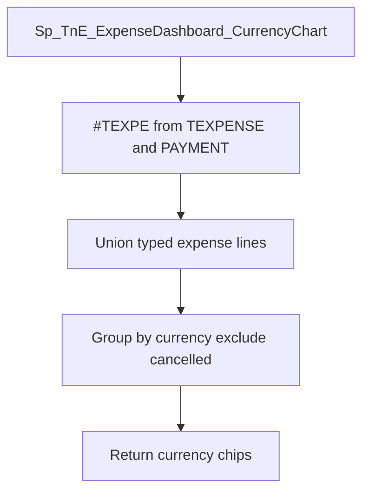

# Sp_TnE_ExpenseDashboard_CurrencyChart

## What it does

Returns the currency chips for the Expense Dashboard: each request currency code present on submitted expense lines in the employer/date window, with line count and `CurrencyId`. Filters `TEXPENSE` + `TEXPENSE_PAYMENT` first, unions the same typed expense tables as the chart SP (including custom `TEXPENSE_LINE_ITEMS`), excludes expenses with cancel substatus `511`, and orders with currency id `99` first.

## Parameters

| Name | Direction | What it is for |
|---|---|---|
| `@EmployerID` | in | Employer scope |
| `@LoginEmployeeId` | in | Passed by API; not referenced in the procedure body |
| `@Fromdate` | in | Start of CreatedOn window (nulled when basis is Amount Spent On) |
| `@Todate` | in | End of CreatedOn window |
| `@ReportDataBasedOn` | in | `Amount Spent On` switches filter to BillDate |

## Call sequence

## Callers

No other procedure or function calls this object. App callers: `travelNExpenseDAL.GetExpenseDashboardCurrencyList` → `travelNExpenseController.GetExpenseDashboardCurrencyList` from [Expense Dashboard](/docs/guides/expense-and-reimbursement/expense-dashboard).

## Nested

Calls no other procedures or functions.

## Steps

1. Script is `HRMS-DATABASE/HRMS_TRAVELNEXPENSE/STOREPROCEDURE/Sp_TnE_ExpenseDashboard_CurrencyChart.sql`.
2. If basis is Amount Spent On, move dates onto BillDate variables and null CreatedOn dates.
3. Load `#TEXPE` from submitted `TEXPENSE` joined to `TEXPENSE_PAYMENT` for employer and date window.
4. Union typed expense tables on ExpenseId/SequenceID; left join `TCountry` for currency code.
5. Exclude expenses that have `TEXPENSE_STATUS.SubStatusId = 511`; group by currency and order with id `99` first.

## Tables

| Table | Read or write |
|---|---|
| `TEXPENSE` | read |
| `TEXPENSE_PAYMENT` | read |
| `TEXPENSE_STATUS` | read |
| `TEXPENSE_TRAVEL`, `TEXPENSE_STAY`, `TEXPENSE_CONVEYANCE`, `TEXPENSE_FOODNBEV`, `TEXPENSE_MEDICAL`, `TEXPENSE_OTHER`, `TEXPENSE_PROJECT`, `TEXPENSE_TELEPHONE`, `TEXPENSE_DIMALLOWANCE`, `TEXPENSE_SUPPLIESOFFICE`, `TEXPENSE_AUTO`, `TEXPENSE_PARTSSALES`, `TEXPENSE_LINE_ITEMS` | read |
| `TCountry` | read |

## Unresolved calls

None.

## Flow

