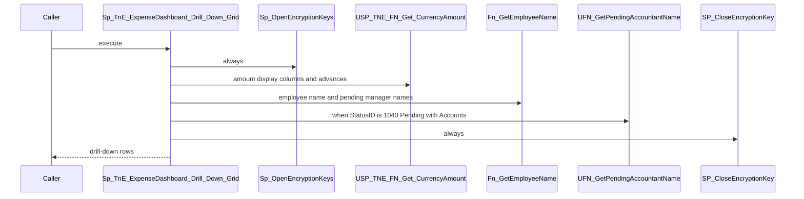
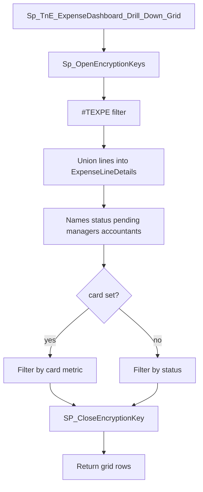

# Sp_TnE_ExpenseDashboard_Drill_Down_Grid

## What it does

Returns the Expense Dashboard drill-down grid of expense line rows for a card click or chart slice. Opens encryption keys, filters `TEXPENSE` + `TEXPENSE_PAYMENT` by employer/date/currency id, unions typed expense lines into `#ExpenseLineDetails`, enriches with employee name/status, BU, travel request, advances, latest status, pending managers (`TRequestWorkflows`), and pending accountants (`UFN_GetPendingAccountantName`), then either filters by metric card name or by request status. Closes encryption keys before return.

## Parameters

| Name | Direction | What it is for |
|---|---|---|
| `@pEmployerId` | in | Employer scope |
| `@pStatus` | in | Status label filter for non-card path; `Completed Requests` remapped via lookup `1080` |
| `@pFromDate` | in | Start of CreatedOn window (nulled when basis is Amount Spent On) |
| `@pToDate` | in | End of CreatedOn window |
| `@pExpenseType` | in | Intended type label filter; not applied in the final SELECT |
| `@LoginEmployeeId` | in | Passed by API; not referenced in the procedure body |
| `@ReportDataBasedOn` | in | `Amount Spent On` switches filter to BillDate |
| `@Currency` | in | Currency code string; resolve-to-id logic is commented out |
| `@card` | in | Card title when drilling from a metric card |
| `@ExpenseGroupId` | in | Optional group id; group filter block is commented out |
| `@ExpenseGroupName` | in | Optional group name; group filter block is commented out |
| `@ExpenseTypeID` | in | When set, keeps only matching ExpenseTypeID rows after the union |
| `@CurrencyId` | in | Filters `TEXPENSE_PAYMENT.ReqCurrencyCodeId` (referenced as `@currencyid`) |

## Call sequence

## Callers

No other procedure or function calls this object. App callers: `travelNExpenseDAL.GetExpenseDetailsForDashboard` → `travelNExpenseController.GetExpenseDetailsForDashboard` from [Expense Dashboard](/docs/guides/expense-and-reimbursement/expense-dashboard).

## Nested

| Object | Kind | When | Page |
|---|---|---|---|
| `Sp_OpenEncryptionKeys` | procedure | always at start | [Sp_OpenEncryptionKeys](/docs/database/hrms/Sp_OpenEncryptionKeys) |
| `USP_TNE_FN_Get_CurrencyAmount` | function | amount / advance display text | [USP_TNE_FN_Get_CurrencyAmount](/docs/database/hrms-travelnexpense/USP_TNE_FN_Get_CurrencyAmount) |
| `Fn_GetEmployeeName` | function | employee and pending manager names | [Fn_GetEmployeeName](/docs/database/hrms/Fn_GetEmployeeName) |
| `UFN_GetPendingAccountantName` | function | StatusID 1040 accountant pending-with | [UFN_GetPendingAccountantName](/docs/database/hrms-travelnexpense/UFN_GetPendingAccountantName) |
| `SP_CloseEncryptionKey` | procedure | always before end | [SP_CloseEncryptionKey](/docs/database/hrms/SP_CloseEncryptionKey) |

## Steps

1. Script is `HRMS-DATABASE/HRMS_TRAVELNEXPENSE/STOREPROCEDURE/Sp_TnE_ExpenseDashboard_Drill_Down_Grid.sql`.
2. Remap Completed Requests status text from lookup `1080` when needed; execute `Sp_OpenEncryptionKeys`.
3. Load `#TEXPE` from `TEXPENSE`/`TEXPENSE_PAYMENT` for employer, `@CurrencyId`, and date window (no `IsSubmitted = 1` predicate here).
4. Union typed expense tables into `#ExpenseLineDetails`, then apply `WHERE ExpenseTypeID = TRY_CAST(@ExpenseTypeID AS INT)`.
5. Build `#ExpenseRequest` with employee, BU, status, travel, advances; resolve pending managers and accountants; apply stalled/loading email-notification overrides.
6. If `@card` is set, filter by the four card rules; else filter by `@pStatus`. Execute `SP_CloseEncryptionKey`.

## Tables

| Table | Read or write |
|---|---|
| `TEXPENSE` | read |
| `TEXPENSE_PAYMENT` | read |
| `TEXPENSE_STATUS` | read |
| Typed `TEXPENSE_*` tables and `TEXPENSE_LINE_ITEMS` | read |
| `TLOOKUP` | read |
| `TCountry` | read |
| `TEmployeeInfo`, `TEmployee`, `TOrgHierarchyDetails`, `TEmployerDetails` | read (synonyms) |
| `TTRAVEL_REQUEST`, `TExpense_Advances` | read |
| `TRequestWorkflows`, `TWorkflowManagement`, `TWorkflowDetails` | read |
| `TEMAIL_NOTIFICATION` | read |

## Unresolved calls

None.

## Flow

