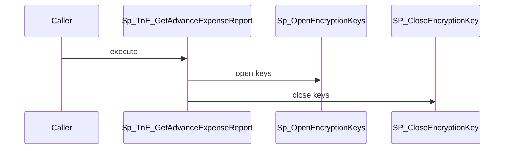
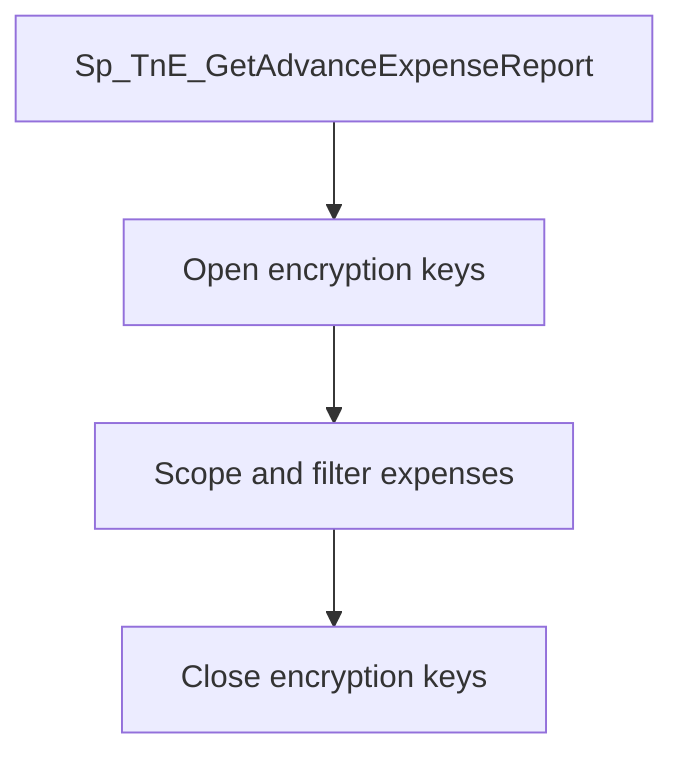

# Sp_TnE_GetAdvanceExpenseReport

## What it does

Same ERP-style report path for advance expense searches (`GetAdvanceExpenseReportData` when advance filter is true).

## Parameters

| Name | Direction | What it is for |
|---|---|---|
| `@pEmployerId` | in | Employer id or CSV |
| `@pViewType` | in | `E` / `M` / `A` / `F` |
| `@pEmployeeId` | in | Actor for scoping |
| `@pStatusId` | in | Status CSV |
| `@pIsAdvanceRequest` | in | Advance flag |
| `@pFromDate` / `@pToDate` | in | Date window |
| `@pExpenseType` | in | Expense type CSV |
| `@pSpentCurrencyCodeId` / `@pSpentAmount` / `@pSpentOperator` | in | Spent filter |
| `@pReqCurrencyCodeId` / `@pReqestedAmount` / `@pReqOperator` | in | Requested filter |
| `@pApprovedAmount` | in | Approved amount filter |

## Call sequence

## Callers

| Caller | Page |
|---|---|
| matching T&E DAL method | [Report](/docs/guides/expense-and-reimbursement/report) |

## Nested

| Object | Kind | When | Page |
|---|---|---|---|
| `Sp_OpenEncryptionKeys` | procedure | start of body | [Sp_OpenEncryptionKeys](/docs/database/hrms/Sp_OpenEncryptionKeys) |
| `SP_CloseEncryptionKey` | procedure | end of body | [SP_CloseEncryptionKey](/docs/database/hrms/SP_CloseEncryptionKey) |

## Steps

1. Open encryption keys.
2. Build employer/expense-type/employee scope from view type.
3. Filter expense details by amount operators, status, and dates.
4. Close encryption keys and return rows.

## Tables

| Table | Read or write |
|---|---|
| `VE_TNE_ExpenseDetails` / `TEXPENSE` / `TEXPENSE_STATUS` | read |
| `TLOOKUP` / `TCountry` | read |
| `TEMPLOYEE` / `TEmployeeInfo` / `TORGChart` / `TOrgHierarchyDetails` | read |

## Unresolved calls

None beyond encryption open/close.

## Flow

