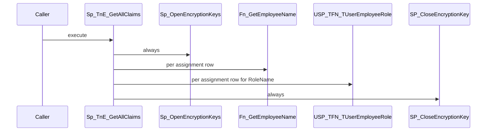
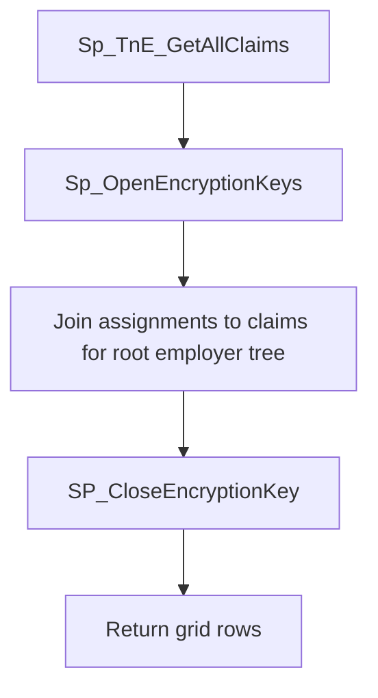

# Sp_TnE_GetAllClaims

## What it does

Returns the View Permission grid: employment number, employee name, role name, claim text, and module id for every `TCLAIM_ASSIGNMENT` row with `EmployeeId > 0` under the same root employer as `@pEmployerId`. Opens encryption keys around the read.

## Parameters

| Name | Direction | What it is for |
|---|---|---|
| `@pEmployerId` | in | Employer used to resolve `RootEmployerId` and include sibling employers |

## Call sequence

## Callers

No other procedure or function calls this object. App callers: `EmployeeDAL.GetAllClaims` → `EmployeeController.GetAllClaims` from [Permission Setup](/docs/guides/admin-configuration/permission-setup) View Permission tab.

## Nested

| Object | Kind | When | Page |
|---|---|---|---|
| `Sp_OpenEncryptionKeys` | procedure | always | [Sp_OpenEncryptionKeys](/docs/database/hrms/Sp_OpenEncryptionKeys) |
| `Fn_GetEmployeeName` | function | per row | [Fn_GetEmployeeName](/docs/database/hrms/Fn_GetEmployeeName) |
| `USP_TFN_TUserEmployeeRole` | function | per row for role name | [USP_TFN_TUserEmployeeRole](/docs/database/hrms/USP_TFN_TUserEmployeeRole) |
| `SP_CloseEncryptionKey` | procedure | always | [SP_CloseEncryptionKey](/docs/database/hrms/SP_CloseEncryptionKey) |

## Steps

1. Script is `HRMS-DATABASE/HRMS_TRAVELNEXPENSE/STOREPROCEDURE/Sp_TnE_GetAllClaims.sql`.
2. Execute `Sp_OpenEncryptionKeys`.
3. Join `TCLAIM_ASSIGNMENT` to `TCLAIM` where `EmployeeId > 0` and employer is in the root-employer tree of `@pEmployerId`.
4. Resolve employment number from `TEmployeeInfo`, name from `Fn_GetEmployeeName`, and role name from `USP_TFN_TUserEmployeeRole`.
5. Order by employee id and claim id, then execute `SP_CloseEncryptionKey`.

## Tables

| Table | Read or write |
|---|---|
| `TCLAIM_ASSIGNMENT` | read |
| `TCLAIM` | read |
| `TEmployeeInfo` | read (synonym) |
| `TEmployerDetails` | read (synonym) |

## Unresolved calls

None.

## Flow

