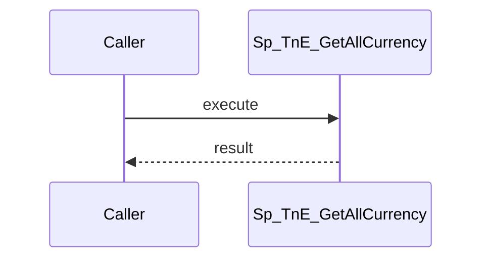
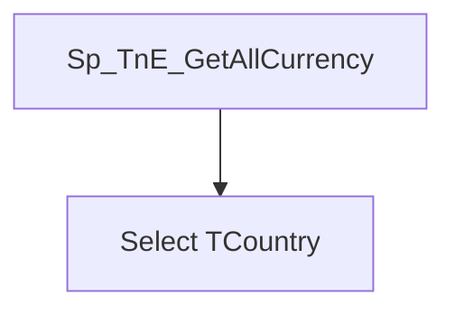

# Sp_TnE_GetAllCurrency

## What it does

Returns every row from `TCountry` ordered by `CURRENCYCODE` for Report currency dropdowns.

## Parameters

None.

## Call sequence

## Callers

| Caller | Page |
|---|---|
| `TravelDAL.GetAllCurrency` | [Report](/docs/guides/expense-and-reimbursement/report) |

## Nested

Calls no other procedures or functions.

## Steps

1. `SELECT * FROM TCountry ORDER BY CURRENCYCODE`.

## Tables

| Table | Read or write |
|---|---|
| `TCountry` | read |

## Unresolved calls

None.

## Flow

