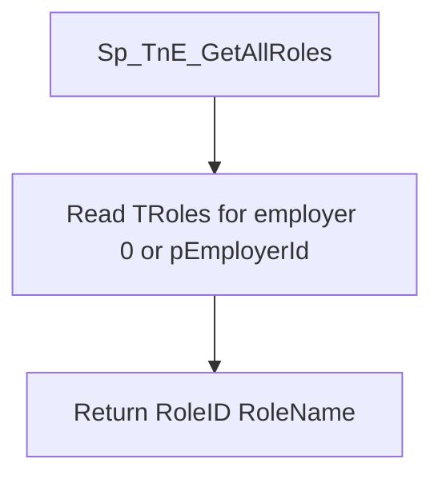

# Sp_TnE_GetAllRoles

## What it does

Returns `RoleID` and `RoleName` from `TRoles` for employer `0` or the requested employer. Permission Setup uses the list for the Setup Permission role dropdown.

## Parameters

| Name | Direction | What it is for |
|---|---|---|
| `@pEmployerId` | in | Employer whose roles are listed, plus shared employer `0` rows |

## Call sequence

Calls no other procedures or functions.

## Callers

No other procedure or function calls this object. App callers: `EmployeeDAL.GetAllRoles` → `EmployeeController.GetAllRoles` from [Permission Setup](/docs/guides/admin-configuration/permission-setup).

## Nested

Calls no other procedures or functions.

## Steps

1. Script is `HRMS-DATABASE/HRMS_TRAVELNEXPENSE/STOREPROCEDURE/Sp_TnE_GetAllRoles.sql`.
2. Select `RoleID`, `RoleName` from `[dbo].[TRoles]` where `Employerid = 0` or `Employerid = @pEmployerId`.

## Tables

| Table | Read or write |
|---|---|
| `TRoles` | read (TRAVELNEXPENSE synonym to HRMS `TRoles`) |

## Unresolved calls

None.

## Flow

