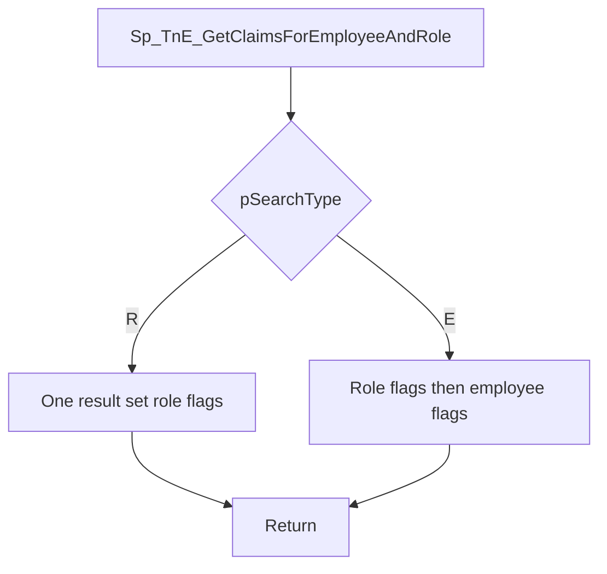

# Sp_TnE_GetClaimsForEmployeeAndRole

## What it does

Returns the T&E permission claim catalog from `TCLAIM` with an `IsClaimExists` bit from `TCLAIM_ASSIGNMENT`. For `searchType` `R` it returns one result set keyed by role. For `searchType` `E` it returns two result sets: role assignments first, then employee assignments. Permission Setup merges those sets in `helper.js` `handleClaimData`.

## Parameters

| Name | Direction | What it is for |
|---|---|---|
| `@pRoleId` | in | Role id when checking role assignments. Default null |
| `@pEmployerId` | in | Employer on `TCLAIM_ASSIGNMENT.Employerid` |
| `@pSearchType` | in | `R` for role mode, `E` for employee mode |
| `@pEmployeeId` | in | Employee id when `@pSearchType` is `E`. Default null |

## Call sequence

Calls no other procedures or functions.

## Callers

No other procedure or function calls this object. App callers: `EmployeeDAL.GetClaimsForEmployeeAndRole` → `EmployeeController.GetClaimsForEmployeeAndRole` from [Permission Setup](/docs/guides/admin-configuration/permission-setup).

## Nested

Calls no other procedures or functions.

## Steps

1. Script is `HRMS-DATABASE/HRMS_TRAVELNEXPENSE/STOREPROCEDURE/Sp_TnE_GetClaimsForEmployeeAndRole.sql`.
2. When `@pSearchType = 'R'`, select every `TCLAIM` row with `IsClaimExists` true when a matching `TCLAIM_ASSIGNMENT` row exists for that claim, role, and employer.
3. When `@pSearchType = 'E'`, first select the same catalog with role-based `IsClaimExists` for `@pRoleId`, then select the catalog again with employee-based `IsClaimExists` for `@pEmployeeId`.

## Tables

| Table | Read or write |
|---|---|
| `TCLAIM` | read |
| `TCLAIM_ASSIGNMENT` | read |

## Unresolved calls

None.

## Flow

