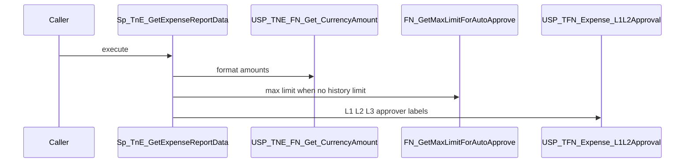
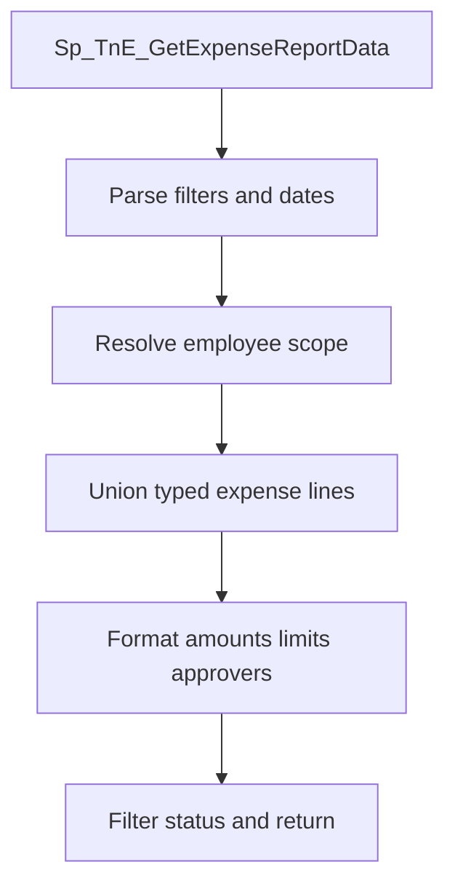

# Sp_TnE_GetExpenseReportData

## What it does

Builds the main **Expense & Reimbursement Report** grid. Resolves employer/status/expense-type/city-category CSV filters, scopes employees by view type (self, manager, admin/accountant) and location-BU access, unions typed expense detail rows with payment and status, formats amounts via currency helpers, and returns one result set filtered to selected statuses.

## Parameters

| Name | Direction | What it is for |
|---|---|---|
| `@pEmployerId` | in | Employer id or CSV |
| `@pViewType` | in | `E` self, `M` manager, `A`/`F` admin or accountant; default `E` |
| `@pEmployeeId` | in | Actor used for view-type scoping |
| `@pStatusId` | in | CSV of status lookup ids; default submitted/pending set |
| `@pIsAdvanceRequest` | in | Optional advance flag filter |
| `@pFromDate` / `@pToDate` | in | Date window |
| `@pExpenseType` | in | CSV of expense-type lookup ids |
| `@pSpentCurrencyCodeId` / `@pSpentAmount` / `@pSpentOperator` | in | Spent-amount filter |
| `@pReqCurrencyCodeId` / `@pReqestedAmount` / `@pReqOperator` | in | Requested-amount filter |
| `@pApprovedAmount` | in | Approved-amount filter |
| `@pCostCenter` / `@pProjectRegion` / `@pPaymentModeId` / `@pBudgetCode` | in | Optional project/region/payment/budget filters |
| `@pissiteallowanceelligble` | in | Site-allowance eligibility filter |
| `@LoginEmployeeId` | in | Location-BU employee scope |
| `@CityCategoryID` | in | CSV city-category filter |
| `@reportBased` | in | `0` created-on window, `1` spent/bill-date window |
| `@isInactive` | in | Include inactive employees when `1` |

## Call sequence

## Callers

| Caller | Page |
|---|---|
| `ReportsDAL.GetExpenseReportData` | [Report](/docs/guides/expense-and-reimbursement/report) |

## Nested

| Object | Kind | When | Page |
|---|---|---|---|
| `USP_TNE_FN_Get_CurrencyAmount` | function | amount display text | [USP_TNE_FN_Get_CurrencyAmount](/docs/database/hrms-travelnexpense/USP_TNE_FN_Get_CurrencyAmount) |
| `FN_GetMaxLimitForAutoApprove` | function | scalar max limit | [FN_GetMaxLimitForAutoApprove](/docs/database/hrms-travelnexpense/FN_GetMaxLimitForAutoApprove) |
| `USP_TFN_Expense_L1L2Approval` | function | outer apply approver labels | [USP_TFN_Expense_L1L2Approval](/docs/database/hrms-travelnexpense/USP_TFN_Expense_L1L2Approval) |
| `FN_LocationBU_GetEmployeeDetails` | function | employee scope | [FN_LocationBU_GetEmployeeDetails](/docs/database/hrms/FN_LocationBU_GetEmployeeDetails) |
| `Fn_GetEmployeeName` | function | fallback approver names | [Fn_GetEmployeeName](/docs/database/hrms/Fn_GetEmployeeName) |

## Steps

1. Script `HRMS-DATABASE/HRMS_TRAVELNEXPENSE/STOREPROCEDURE/Sp_TnE_GetExpenseReportData.sql`; sets `READ UNCOMMITTED` and uses `NOLOCK` on report reads.
2. Split employer/status/expense-type/city-category CSVs into temp tables; map `@reportBased` onto created vs spent date variables.
3. Build employee scope from view type plus `FN_LocationBU_GetEmployeeDetails`.
4. Load `#TEXPE` from `TEXPENSE` joined to payments and unions of typed detail tables.
5. Project amounts, limits, status text, and L1/L2/L3 labels; filter cancelled status `511` and selected status ids.

## Tables

| Table | Read or write |
|---|---|
| `TEXPENSE` | read |
| `TEXPENSE_PAYMENT` | read |
| `TEXPENSE_STATUS` | read |
| Typed expense detail tables (`TEXPENSE_TRAVEL`, `TEXPENSE_STAY`, …) | read |
| `TLOOKUP` / `TCountry` | read |
| `TEMPLOYEE` / `TEmployeeInfo` / `TORGChart` | read |
| `TExpense_Limit` / `TLevelWiseExpenseDetails` / history | read |
| `Texpense_ApproverComments` | read |

## Unresolved calls

None beyond nested functions listed above.

## Flow

