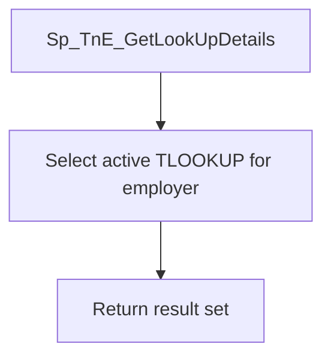

# Sp_TnE_GetLookUpDetails

## What it does

Stored procedure `Sp_TnE_GetLookUpDetails`. Returns active hierarchical lookup rows for one employer from `TLOOKUP`, including parent text via a correlated subquery. Excludes lookup ids `100` and `101`. Calls no other procedure or function.

## Parameters

| Name | Direction | What it is for |
|---|---|---|
| `@pEmployerid` | in | INT — employer scope (`0` is the shared master catalogue) |

## Call sequence

Calls no other procedures or functions.

## Callers

No other procedure or function in this database calls this object. Application caller: Travel WebAPI `GetLookupItems` via `TravelDAL.GetLookupItems`.

| Caller | Page |
|---|---|
| (application only) | No page yet |

## Nested

Calls no other procedures or functions.

## Steps

1. Script is `HRMS-DATABASE/HRMS_TRAVELNEXPENSE/STOREPROCEDURE/Sp_TnE_GetLookUpDetails.sql`.
2. `SET NOCOUNT ON`.
3. Select lookup id, text, parent id, sub-parent id, parent text (from same-employer parent row), additional info, cost center, employer id, lookup configuration, and display id.
4. Filter to `isDeleted` null or 0, `Lookup_ID` not in (100, 101), and matching `@pEmployerid`.

## Tables

| Table | Read or write |
|---|---|
| `TLOOKUP` | read |

## Flow

