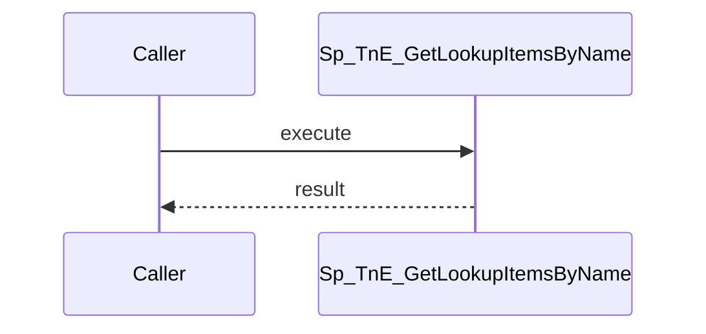
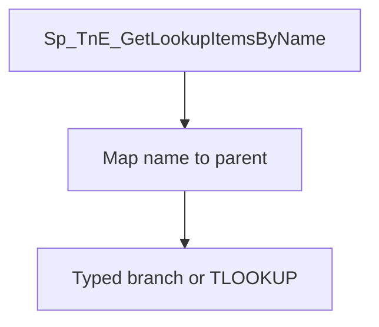

# Sp_TnE_GetLookupItemsByName

## What it does

Resolves a named lookup type (`ExpenseType`, `PaymentMode`, `ReportBased`, travel variants, `ProjectName`, visa, currency, …) and returns matching lookup/project/country rows for one employer. Report filters call it via `TravelDAL.GetLookupItemsByType`.

## Parameters

| Name | Direction | What it is for |
|---|---|---|
| `@LookUpName` | in | Lookup type name |
| `@pEmployerid` | in | Employer scope |

## Call sequence

## Callers

| Caller | Page |
|---|---|
| `TravelDAL.GetLookupItemsByName` via `GetLookupItemsByType` | [Report](/docs/guides/expense-and-reimbursement/report) |

## Nested

Calls no other procedures or functions.

## Steps

1. Map `@LookUpName` to a root lookup id (ExpenseType `700`, PaymentMode `350`, …).
2. Branch for VisaType / ProjectName / ExpenseType / Currency / CostEstimationType.
3. Default branch selects `TLOOKUP` children for the resolved parent and employer.

## Tables

| Table | Read or write |
|---|---|
| `TLOOKUP` | read |
| `TVisaType` | read |
| `TProject` / `TClientProjectMapping` | read |
| `TCountry` | read |

## Unresolved calls

None.

## Flow

